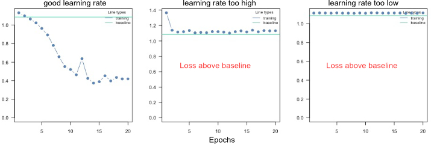

# Train a Convolutional Neural Network (CNN)

This function trains a Convolutional Neural Network (CNN) on the
provided input data `X` and the target data `Y` using the specified
architecture, loss function, and optimizer.

## Usage

``` r
cnn(
  X,
  Y = NULL,
  architecture = NULL,
  custom = NULL,
  loss = c("mse", "mae", "cross-entropy", "bernoulli", "gaussian", "binomial", "poisson",
    "mvp", "nbinom", "multinomial", "clogit", "softmax"),
  custom_parameters = NULL,
  optimizer = c("sgd", "adam", "adadelta", "adagrad", "rmsprop", "rprop", "ignite_adam"),
  lr = 0.01,
  lr_scheduler = NULL,
  alpha = 0.5,
  lambda = 0,
  validation = 0,
  batchsize = NULL,
  shuffle = TRUE,
  data_augmentation = NULL,
  num_workers = 0L,
  num_threads = 4L,
  epochs = 100,
  weights = NULL,
  early_stopping = Inf,
  burnin = Inf,
  baseloss = NULL,
  device = c("cpu", "cuda", "mps"),
  plot = TRUE,
  verbose = TRUE
)
```

## Arguments

- X:

  An array of input data with a minimum of 3 and a maximum of 5
  dimensions. The first dimension represents the samples, the second
  dimension represents the channels, and the third to fifth dimensions
  represent the input dimensions. As an alternative, you can provide the
  relative or absolute path to the folder containing the images. In this
  case, unsigned integer images are divided by their maximum value (255
  for 8 bit, 65535 for 16 bit), and floating point and signed integer
  TIFFs are passed unchanged. Windows of one large raster are given with
  [`raster_patches`](raster_patches.md).

- Y:

  The target data. The allowed formats of the target data differ between
  loss functions. See [`dnn`](dnn.md) for more information.

- architecture:

  An object of class 'citoarchitecture'. See
  [`create_architecture`](create_architecture.md) for more information.
  Ignored if custom is provided.

- custom:

  custom network architecture, replaces the architecture argument.
  Either an
  [`nn_module`](https://torch.mlverse.org/docs/reference/nn_module.html)
  generator, an instantiated nn_module, or a list(module = generator,
  args = list(...), output_dim = integer). If the initialize method has
  arguments named input or output, they are filled in automatically
  (input = input shape, e.g. c(channels, height, width), output = output
  dimension expected by the loss). The forward method receives a float
  tensor of shape (batch, input_shape) and must return a tensor of shape
  (batch, output). See [`dnn`](dnn.md) for details

- loss:

  The loss function to be used. Options include "mse", "mae",
  "cross-entropy", "bernoulli", "gaussian", "binomial", "poisson",
  "nbinom", "mvp", "multinomial", and "clogit". You can also specify
  your own loss function. See Details for more information. Default is
  "mse".

- custom_parameters:

  Parameters for the custom loss function. See the vignette for an
  example. Default is NULL.

- optimizer:

  The optimizer to be used. Options include "sgd", "adam", "adadelta",
  "adagrad", "rmsprop", "rprop", and "ignite_adam". See
  [`config_optimizer`](config_optimizer.md) for further adjustments to
  the optimizer. Default is "sgd".

- lr:

  Learning rate for the optimizer. Default is 0.01.

- lr_scheduler:

  Learning rate scheduler. See
  [`config_lr_scheduler`](config_lr_scheduler.md) for creating a
  learning rate scheduler. Default is NULL.

- alpha:

  Alpha value for L1/L2 regularization. Default is 0.5.

- lambda:

  Lambda value for L1/L2 regularization. Default is 0.0.

- validation:

  Proportion of the data to be used for validation. Alternatively, a
  vector containing the indices of the validation samples can be
  provided. Default is 0.0.

- batchsize:

  Batch size for training. If NULL, batchsize is 10% of the training
  data. Default is NULL.

- shuffle:

  Whether to shuffle the data before each epoch. Default is TRUE.

- data_augmentation:

  A list of functions used for data augmentation. Elements must be
  either functions or strings corresponding to inbuilt data augmentation
  functions. See details for more information.

- num_workers:

  (integer) Number of worker processes for the dataloader. Only
  effective for folder inputs; raster inputs from
  [`raster_patches`](raster_patches.md) always use 0 and prefetch in a
  reader thread instead. 0 decodes in the main process.

- num_threads:

  (integer) Number of threads the compiled image decoder uses per batch
  for folder inputs, and the number of reader threads for raster inputs
  from [`raster_patches`](raster_patches.md).

- epochs:

  Number of epochs to train the model. Default is 100.

- weights:

  weights or other values (can be also a matrix) that the likelihood has
  access to

- early_stopping:

  Number of epochs with no improvement after which training will be
  stopped. Default is Inf.

- burnin:

  Number of epochs after which the training stops if the loss is still
  above the baseloss. Default is Inf.

- baseloss:

  Baseloss used for burnin and plot. If NULL, the baseloss corresponds
  to intercept only models. Default is NULL.

- device:

  Device to be used for training. Options are "cpu", "cuda", and "mps".
  Default is "cpu".

- plot:

  Whether to plot the training progress. Default is TRUE.

- verbose:

  Whether to print detailed training progress. Default is TRUE.

## Value

An S3 object of class `"citocnn"` is returned. It is a list containing
everything there is to know about the model and its training process.
The list consists of the following attributes:

- net:

  An object of class "nn_module". Originates from the torch package and
  represents the core object of this workflow.

- call:

  The original function call.

- loss:

  An object of class "nn_module". Contains all relevant information for
  the loss function, e.g. parameters and a function (format_Y) that
  transforms target data.

- data:

  A list. Contains the data used for the training of the model.

- model_properties:

  A list of properties, that define the architecture of the model.

- training_properties:

  A list of all training hyperparameters used the last time the model
  was trained.

- losses:

  A data.frame containing training and validation losses of each epoch.

- best_epoch_net_state_dict:

  Serialized state dict of net from the best training epoch.

- best_epoch_loss_state_dict:

  Serialized state dict of loss from the best training epoch.

- last_epoch_net_state_dict:

  Serialized state dict of net from the last training epoch.

- last_epoch_loss_state_dict:

  Serialized state dict of loss from the last training epoch.

- use_model_epoch:

  String, either "best" or "last". Determines whether the parameters
  (e.g. weights, biases) from the best or the last training epoch are
  used (e.g. for prediction).

- loaded_model_epoch:

  String, shows from which training epoch the parameters are currently
  loaded in `net` and `loss`.

## Details:

Also check [`dnn`](dnn.md) for details to common arguments.

## Convolutional Neural Networks:

Convolutional Neural Networks (CNNs) are a specialized type of neural
network designed for processing structured data, such as images. The key
components of a CNN are convolutional layers, pooling layers and
fully-connected (linear) layers:

- **Convolutional layers** are the core building blocks of CNNs. They
  consist of filters (also called kernels), which are small, learnable
  matrices. These filters slide over the input data to perform
  element-wise multiplication, producing feature maps that capture local
  patterns and features. Multiple filters are used to detect different
  features in parallel. They help the network learn hierarchical
  representations of the input data by capturing low-level features
  (edges, textures) and gradually combining them (in subsequent
  convolutional layers) to form higher-level features.

- **Pooling layers** reduce the size of the feature maps created by
  convolutional layers, while retaining important information. A common
  type is max pooling, which keeps the highest value in a region,
  simplifying the data while preserving essential features.

- **Fully-connected (linear) layers** connect every neuron in one layer
  to every neuron in the next layer. These layers are found at the end
  of the network and are responsible for combining high-level features
  to make final predictions.

The architecture of the CNN that will be created and trained by this
function is defined by an object of class 'citoarchitecture'. See
[`create_architecture`](create_architecture.md) for detailed information
on how to define and customize your CNN architecture.

## Data Augmentation

Data augmentation is a technique used to improve the generalization of
convolutional neural networks (CNNs) by increasing the diversity of the
training data through random transformations. This function supports
data augmentation through the `data_augmentation` argument, which
accepts a list containing either user-defined functions or the names of
cito's built-in data augmentation functions. Each user-defined function
must take a `torch_tensor` as input and return a `torch_tensor` with the
same shape. The input tensor must have 3 to 5 dimensions with the
following structure:

- Dimension 1: singleton batch dimension (i.e., size 1),

- Dimension 2: channel dimension,

- Dimensions 3 to 5: spatial dimensions (e.g., X, Y, Z).

During training, the data loader re-loads each sample at every epoch,
applying all provided augmentation functions sequentially each time the
sample is accessed. This allows transformations to vary across epochs if
the functions include randomness (e.g., randomly flipping a spatial
axis) helping the model learn invariance to such changes. In addition to
custom functions, the list can contain the names (as strings) of the
following built-in augmentation methods:

- `"rotate90"`:

  - For 2D convolutions: randomly applies one of the 4 possible 90°
    rotations. The X and Y dimensions have to be equal.

  - For 3D convolutions:

    - If X, Y, and Z dimensions are equal: randomly applies one of the
      24 possible 90° rotations.

    - If only two spatial dimensions are equal: randomly applies one of
      the 4 possible 90° rotations in the plane of the two spatial
      dimensions.

  - Not available for 1D convolutions.

- `"flip"`: Randomly flips each spatial dimension independently with 50%
  probability.

- `"noise"`: Adds a small amount of normally distributed noise to the
  tensor.

## Training and convergence of neural networks

Ensuring convergence can be tricky when training neural networks. Their
training is sensitive to a combination of the learning rate (how much
the weights are updated in each optimization step), the batch size (a
random subset of the data is used in each optimization step), and the
number of epochs (number of optimization steps). Typically, the learning
rate should be decreased with the size of the neural networks (depth of
the network and width of the hidden layers). We provide a baseline loss
(intercept only model) that can give hints about an appropriate learning
rate:



If the training loss of the model doesn't fall below the baseline loss,
the learning rate is either too high or too low. If this happens, try
higher and lower learning rates.

A common strategy is to try (manually) a few different learning rates to
see if the learning rate is on the right scale.

See the troubleshooting vignette
([`vignette("B-Training_neural_networks")`](../articles/B-Training_neural_networks.md))
for more help on training and debugging neural networks.

## See also

[`predict.citocnn`](predict.citocnn.md),
[`print.citocnn`](print.citocnn.md), [`plot.citocnn`](plot.citocnn.md),
[`summary.citocnn`](summary.citocnn.md),
[`coef.citocnn`](coef.citocnn.md),
[`continue_training`](continue_training.md),
[`analyze_training`](analyze_training.md)

## Author

Armin Schenk

## Examples

``` r
# \donttest{
if(torch::torch_is_installed()){
library(cito)

# Example workflow in cito

device <- ifelse(torch::cuda_is_available(), "cuda", "cpu")

## Data
### We generate our own data:
### 320 images (3x50x50) of either rectangles or ellipsoids
shapes <- cito:::simulate_shapes(n=320, size=50, channels=3)
X <- shapes$data
Y <- shapes$labels

## Architecture
### Declare the architecture of the CNN
### Note that the output layer is added automatically by cnn()
architecture <- create_architecture(conv(5), maxPool(), conv(5), maxPool(), linear(10))

## Build and train network
### cross-entropy (softmax link) for classification
cnn.fit <- cnn(X, Y, architecture, loss = "cross-entropy",
               epochs = 2, validation = 0.1, lr = 0.05, device=device)

## The training loss is below the baseline loss but at the end of the
## training the loss was still decreasing, so continue training for another 5
## epochs
cnn.fit <- continue_training(cnn.fit, epochs = 5)

# Structure of Neural Network
print(cnn.fit)

# Plot Neural Network
plot(cnn.fit)

## Convergence can be tested via the analyze_training function
analyze_training(cnn.fit)

## Transfer learning
### With the transfer() function we can use predefined architectures with pretrained weights
transfer_architecture <- create_architecture(transfer("resnet18"))
resnet <- cnn(X, Y, transfer_architecture, loss = "cross-entropy",
              epochs = 1, validation = 0.1, lr = 0.05, device=device)
print(resnet)
plot(resnet)
}
#> Loss at epoch 1: training: 0.693, validation: 0.699, lr: 0.05000

#> Loss at epoch 2: training: 0.690, validation: 0.704, lr: 0.05000
#> Loss at epoch 3: training: 0.689, validation: 0.708, lr: 0.05000

#> Loss at epoch 4: training: 0.688, validation: 0.711, lr: 0.05000
#> Loss at epoch 5: training: 0.687, validation: 0.715, lr: 0.05000
#> Loss at epoch 6: training: 0.686, validation: 0.717, lr: 0.05000
#> Loss at epoch 7: training: 0.685, validation: 0.722, lr: 0.05000
#> cnn(X = X, Y = Y, architecture = architecture, loss = "cross-entropy", 
#>     lr = 0.05, validation = 0.1, epochs = 2, device = device)
#> -------------------------------------------------------------------------------
#> Convolution|Input: 3x50x50
#>            |Output: 5x48x48
#>            |Kernel: 3x3 (stride=1x1, padding=0x0, dilation=1x1)
#>            |Bias: TRUE
#>            |Activation: relu
#> -------------------------------------------------------------------------------
#> MaxPool    |Input: 5x48x48
#>            |Output: 5x24x24
#>            |Kernel: 2x2 (stride=2x2, padding=0x0, dilation=1x1)
#> -------------------------------------------------------------------------------
#> Convolution|Input: 5x24x24
#>            |Output: 5x22x22
#>            |Kernel: 3x3 (stride=1x1, padding=0x0, dilation=1x1)
#>            |Bias: TRUE
#>            |Activation: relu
#> -------------------------------------------------------------------------------
#> MaxPool    |Input: 5x22x22
#>            |Output: 5x11x11
#>            |Kernel: 2x2 (stride=2x2, padding=0x0, dilation=1x1)
#> -------------------------------------------------------------------------------
#> Linear     |Input: 605
#>            |Output: 10
#>            |Bias: TRUE
#>            |Activation: relu
#> -------------------------------------------------------------------------------
#> Linear     |Input: 10
#>            |Output: 2
#>            |Bias: TRUE
#>            |Activation: Depends on loss
#> -------------------------------------------------------------------------------

#> Model weights for <resnet18> (~45 MB) will be downloaded and processed if not
#> already available.
#> Loss at epoch 1: training: 1.810, validation: 0.078, lr: 0.05000

#> cnn(X = X, Y = Y, architecture = transfer_architecture, loss = "cross-entropy", 
#>     lr = 0.05, validation = 0.1, epochs = 1, device = device)
#> -------------------------------------------------------------------------------
#> Transfer   |Input: 3x50x50
#>            |Output: 512x1x1
#>            |Network: resnet18
#>            |Pretrained: TRUE
#>            |Weights frozen: TRUE
#> -------------------------------------------------------------------------------
#> Linear     |Input: 512
#>            |Output: 2
#>            |Bias: TRUE
#>            |Activation: Depends on loss
#> -------------------------------------------------------------------------------

# }
```
