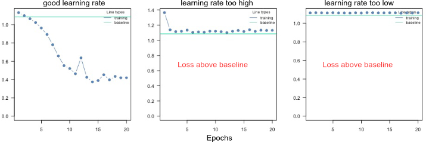
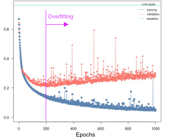

# DNN

fits a custom deep neural network using the Multilayer Perceptron
architecture. `dnn()` supports the formula syntax and allows to
customize the neural network to a maximal degree.

## Usage

``` r
dnn(
  formula = NULL,
  data = NULL,
  hidden = c(50L, 50L),
  activation = "selu",
  bias = TRUE,
  dropout = 0,
  custom = NULL,
  loss = c("mse", "mae", "cross-entropy", "bernoulli", "gaussian", "binomial", "poisson",
    "mvp", "nbinom", "multinomial", "clogit", "softmax"),
  custom_parameters = NULL,
  optimizer = c("sgd", "adam", "adadelta", "adagrad", "rmsprop", "rprop", "ignite_adam"),
  lr = 0.01,
  lr_scheduler = NULL,
  alpha = 0.5,
  lambda = 0,
  validation = 0,
  batchsize = NULL,
  shuffle = TRUE,
  epochs = 100,
  weights = NULL,
  early_stopping = Inf,
  burnin = Inf,
  baseloss = NULL,
  device = c("cpu", "cuda", "mps"),
  plot = TRUE,
  verbose = TRUE,
  bootstrap = NULL,
  bootstrap_parallel = FALSE,
  bootstrap_blocking_variable = NULL,
  tuning = config_tuning(),
  hooks = NULL,
  ce = TRUE,
  ce_method = c("analytical", "finite"),
  X = NULL,
  Y = NULL
)
```

## Arguments

- formula:

  an object of class
  "[`formula`](https://rdrr.io/r/stats/formula.html)": a description of
  the model that should be fitted

- data:

  matrix or data.frame with features/predictors and response variable

- hidden:

  hidden units in layers, length of hidden corresponds to number of
  layers

- activation:

  activation functions, can be of length one, or a vector of different
  activation functions for each layer

- bias:

  whether use biases in the layers, can be of length one, or a vector
  (number of hidden layers + 1 (last layer)) of logicals for each layer.

- dropout:

  dropout rate, probability of a node getting left out during training
  (see
  [`nn_dropout`](https://torch.mlverse.org/docs/reference/nn_dropout.html))

- custom:

  custom network architecture, replaces the default MLP that is built
  from hidden, activation, bias, and dropout (these are ignored if
  custom is provided). Either an
  [`nn_module`](https://torch.mlverse.org/docs/reference/nn_module.html)
  generator, an instantiated nn_module, or a list(module = generator,
  args = list(...), output_dim = integer). See details

- loss:

  loss after which network should be optimized. Can also be distribution
  from the stats package or own function, see details

- custom_parameters:

  List of parameters/variables to be optimized. Can be used in a custom
  loss function. See Vignette for example.

- optimizer:

  which optimizer used for training the network, for more adjustments to
  optimizer see [`config_optimizer`](config_optimizer.md)

- lr:

  learning rate given to optimizer

- lr_scheduler:

  learning rate scheduler created with
  [`config_lr_scheduler`](config_lr_scheduler.md)

- alpha:

  add L1/L2 regularization to training \\(1 - \alpha) \* \|weights\| +
  \alpha \|\|weights\|\|\_2\\ will get added for each layer (the L2 part
  is the Euclidean norm, not its square). Must be between 0 and 1

- lambda:

  strength of regularization: lambda penalty, \\\lambda \* (L1 + L2)\\
  (see alpha)

- validation:

  percentage of data set that should be taken as validation set (chosen
  randomly). Alternatively, a vector containing the indices of the
  validation samples can be provided.

- batchsize:

  number of samples that are used to calculate one learning rate step,
  default is 10% of the training data

- shuffle:

  if TRUE, data in each batch gets reshuffled every epoch

- epochs:

  epochs the training goes on for

- weights:

  weights or other values (can be also a matrix) that the likelihood has
  access to. Only custom loss functions with a `weights` argument accept
  them.

- early_stopping:

  if set to an integer, training stops when the loss has increased for
  the specified number of epochs in a row. The validation loss is used
  when a validation set is available, otherwise the training loss is
  used.

- burnin:

  training is aborted if the training loss is not below the baseline
  loss after burnin epochs

- baseloss:

  baseloss, if null baseloss corresponds to intercept only models

- device:

  device on which network should be trained on. mps correspond to M1/M2
  GPU devices.

- plot:

  plot training loss

- verbose:

  print training and validation loss of epochs

- bootstrap:

  bootstrap neural network or not, numeric corresponds to number of
  bootstrap samples

- bootstrap_parallel:

  parallelize (CPU) bootstrapping

- bootstrap_blocking_variable:

  variable/vector that will be used for blocked bootstrapping (should be
  a factor)

- tuning:

  tuning options created with [`config_tuning`](config_tuning.md)

- hooks:

  list of functions that are executed after each epoch (can be used to
  calculate summary statistics after each epoch)

- ce:

  whether to calculate the conditional effects after training. TRUE
  calculates them on at most 5000 observations, and on fewer if the
  model has many features (the stored effects grow with the number of
  features squared); a number sets the number of observations directly.
  FALSE turns them off, in which case
  [`conditionalEffects`](conditionalEffects.md) and the "ce"/"ale"
  importances calculate them on demand.

- ce_method:

  analytical or finite method

- X:

  Feature matrix or data.frame, alternative data interface

- Y:

  Response vector, factor, matrix or data.frame, alternative data
  interface

## Value

An S3 object of class `"citodnn"` is returned. It is a list containing
everything there is to know about the model and its training process.
The list consists of the following attributes:

- net:

  An object of class "nn_module". Originates from the torch package and
  represents the core object of this workflow.

- call:

  The original function call.

- loss:

  An object of class "nn_module". Contains all relevant information for
  the loss function, e.g. parameters and a function (format_Y) that
  transforms target data.

- data:

  A list. Contains the data used for the training of the model.

- model_properties:

  A list of properties, that define the architecture of the model.

- training_properties:

  A list of all training hyperparameters used the last time the model
  was trained.

- losses:

  A data.frame containing training and validation losses of each epoch.

- best_epoch_net_state_dict:

  Serialized state dict of net from the best training epoch.

- best_epoch_loss_state_dict:

  Serialized state dict of loss from the best training epoch.

- last_epoch_net_state_dict:

  Serialized state dict of net from the last training epoch.

- last_epoch_loss_state_dict:

  Serialized state dict of loss from the last training epoch.

- use_model_epoch:

  String, either "best" or "last". Determines whether the parameters
  (e.g. weights, biases) from the best or the last training epoch are
  used (e.g. for prediction).

- loaded_model_epoch:

  String, shows from which training epoch the parameters are currently
  loaded in `net` and `loss`.

## How neural networks work

In Multilayer Perceptron (MLP) networks, each neuron is connected to
every neuron in the previous layer and every neuron in the subsequent
layer. The value of each neuron is computed using a weighted sum of the
outputs from the previous layer, followed by the application of an
activation function. Specifically, the value of a neuron is calculated
as the weighted sum of the outputs of the neurons in the previous layer,
combined with a bias term. This sum is then passed through an activation
function, which introduces non-linearity into the network. The
calculated value of each neuron becomes the input for the neurons in the
next layer, and the process continues until the output layer is reached.
The choice of activation function and the specific weight values
determine the network's ability to learn and approximate complex
relationships between inputs and outputs.

Therefore the value of each neuron can be calculated using: \\ a
(\sum_j{ w_j \* a_j})\\. Where \\w_j\\ is the weight and \\a_j\\ is the
value from neuron j to the current one. a() is the activation function,
e.g. \\ relu(x) = max(0,x)\\

## Training and convergence of neural networks

Ensuring convergence can be tricky when training neural networks. Their
training is sensitive to a combination of the learning rate (how much
the weights are updated in each optimization step), the batch size (a
random subset of the data is used in each optimization step), and the
number of epochs (number of optimization steps). Typically, the learning
rate should be decreased with the size of the neural networks (depth of
the network and width of the hidden layers). We provide a baseline loss
(intercept only model) that can give hints about an appropriate learning
rate:



If the training loss of the model doesn't fall below the baseline loss,
the learning rate is either too high or too low. If this happens, try
higher and lower learning rates.

A common strategy is to try (manually) a few different learning rates to
see if the learning rate is on the right scale.

See the troubleshooting vignette
([`vignette("B-Training_neural_networks")`](../articles/B-Training_neural_networks.md))
for more help on training and debugging neural networks.

## Loss functions / Likelihoods

We support loss functions and likelihoods for different tasks:

|  |  |  |  |
|----|----|----|----|
| Name | Explanation | Example / Task | Data Type |
| mse | mean squared error | Regression, predicting continuous values | `numeric` (vector, matrix, or data.frame) |
| mae | mean absolute error | Regression, predicting continuous values | `numeric` (vector, matrix, or data.frame) |
| cross-entropy | categorical cross entropy | Multi-class, species classification | `factor` or `character` (vector, or 1-column matrix/data.frame) |
| softmax | categorical cross entropy (deprecated alias for `cross-entropy`) | Multi-class, species classification | `factor` or `character` (vector, or 1-column matrix/data.frame) |
| gaussian | Normal likelihood | Regression, residual error is also estimated (similar to [`stats::lm()`](https://rdrr.io/r/stats/lm.html)) | `numeric` (vector, matrix, or data.frame) |
| binomial | Binomial likelihood | Classification/Logistic regression, mortality | `factor`/`character` (vector or 1-column matrix/data.frame), a 0/1 vector, or `integer` matrix/data.frame with exactly 2 columns (successes, failures) |
| bernoulli | Bernoulli likelihood | Classification, binary (0/1) outcome per observation | `integer` (0/1 only), vector, matrix, or data.frame |
| poisson | Poisson likelihood | Regression, count data, e.g. species abundances | `numeric` (vector, matrix, or data.frame); not enforced as integer |
| nbinom | Negative binomial likelihood | Regression, count data with dispersion parameter | `numeric` (vector, matrix, or data.frame); not enforced as integer |
| mvp | multivariate probit model | joint species distribution model, multi species (presence absence) | `integer` (0/1 only) matrix/data.frame with \\\ge\\2 columns; vectors/factors not accepted |
| multinomial | Multinomial likelihood | step selection in animal movement models | `factor`/`character` (vector or 1-column matrix/data.frame), or `integer` matrix/data.frame with \\\ge\\2 columns |
| clogit | conditional binomial | step selection in animal movement models | `factor`/`character` (vector or 1-column matrix/data.frame), or `integer` matrix/data.frame with \\\ge\\2 columns |

## Additional structures in the formula

Two special terms change how predictors enter the model:

|  |  |  |  |
|----|----|----|----|
| Structure | Syntax | What it does | Typical use |
| Embedding, [`e`](e.md) | `Y ~ X1 + X2 + e(Site, dim = 2)` | every level of a factor gets a learned vector of `dim` numbers that enters the network as additional input | grouping variables with many levels: sites, plots, individuals, species, years |
| Fixed effect, [`fe`](fe.md) | `Y ~ X1 + X2 + fe(Temp + I(Temp^2))` | the terms bypass the network and are added linearly on the link scale, \\\eta = f(X) + \beta^T x\_{fe}\\ | effects that should be reported as coefficients, or that are known to be linear |

Both can be combined, e.g. `dnn(Y ~ . + fe(Temp) + e(Site))`. A variable
in [`fe()`](fe.md) enters only the linear part.

**Why embeddings.** One-hot coding (or contrasts) treats every level of
a factor as equally distinct: no level is closer to any other. An
embedding represents each level by a vector of `dim` coordinates that is
estimated together with the network (Guo and Berkhahn, 2016,
[doi:10.48550/arXiv.1604.06737](https://doi.org/10.48550/arXiv.1604.06737)
), so the model can discover which levels behave similarly and place
them close together. The coordinates are passed to the first hidden
layer together with the other predictors, and because the network learns
the interactions itself, they modulate all effects jointly and
non-linearly. This is like a joint, non-linear random effect on
everything: a random intercept or slope lets a group deviate in one
effect, and similarity learned for one predictor does not carry over to
another, whereas an embedding maps all differences between the groups
into a `dim`-dimensional space. The network learns how similar the
groups are in their response and whether they differ at all. Similar to
an ordination, groups with similar responses lie close together in the
embedding space, so the fitted embeddings can be inspected afterwards
(`coef(model)[[1]]$e_1.weight`, one row per level; see [`e`](e.md) for a
biplot of the effects).

`dim` controls how much structure the embedding can capture and can be
tuned. `e(lambda = , alpha = )` regularizes the embeddings separately
from the network. Embeddings are identified only up to rotation,
reflection and scale: two fits of the same data give the same
configuration in different coordinates, so align them (e.g. Procrustes)
before comparing, and inspect them across several refits. Embeddings can
also be fixed, e.g. to trait or phylogenetic coordinates, with
`e(weights = , train = FALSE)`.

**Why fixed effects.** A DNN learns every effect flexibly, which makes
single effects hard to report. [`fe()`](fe.md) adds selected terms as in
a GLM, while the network models the rest: \\\beta\\ is returned by
`coef(model)$fixed_effects` and is estimated like a parametric term in a
GAM. The intercept comes from the network. The fixed effects are not
regularized by the global `lambda`, only by `fe(lambda = )`. If the
fixed-effect variables are correlated with the network inputs, a
strongly regularized network can bias \\\beta\\; see [`fe`](fe.md) for
details.

## Finding the right architecture

As with the learning rate, there is no definitive guide to choosing the
right architecture for the right task. However, there are some general
rules/recommendations: In general, wider, and deeper neural networks can
improve generalization - but this is a double-edged sword because it
also increases the risk of overfitting. So, if you increase the width
and depth of the network, you should also add regularization (e.g., by
increasing the lambda parameter, which corresponds to the regularization
strength). Furthermore, in [Pichler & Hartig,
2023](https://arxiv.org/abs/2306.10551), we investigated the effects of
the hyperparameters on the prediction performance as a function of the
data size. For example, we found that the `selu` activation function
outperforms `relu` for small data sizes (\<100 observations).

We recommend starting with moderate sizes (like the defaults), and if
the model doesn't generalize/converge, try larger networks along with a
regularization that helps minimize the risk of overfitting (see
[`vignette("B-Training_neural_networks")`](../articles/B-Training_neural_networks.md)
).

## Overfitting

Overfitting means that the model fits the training data well, but
generalizes poorly to new observations. We can use the validation
argument to detect overfitting. If the validation loss starts to
increase again at a certain point, it often means that the models are
starting to overfit your training data:



**Solutions**:

- Re-train with epochs = point where model started to overfit

- Early stopping, stop training when model starts to overfit, can be
  specified using the `early_stopping=…` argument

- Use regularization (dropout or elastic-net, see next section)

## Regularization

Elastic Net regularization combines the strengths of L1 (Lasso) and L2
(Ridge) regularization. It introduces a penalty term that encourages
sparse weight values while maintaining overall weight shrinkage. By
controlling the sparsity of the learned model, Elastic Net
regularization helps avoid overfitting while allowing for meaningful
feature selection. We advise using elastic net (e.g. lambda = 0.001 and
alpha = 0.2).

Dropout regularization helps prevent overfitting by randomly disabling a
portion of neurons during training. This technique encourages the
network to learn more robust and generalized representations, as it
prevents individual neurons from relying too heavily on specific input
patterns. Dropout has been widely adopted as a simple yet effective
regularization method in deep learning.

By utilizing these regularization methods in your neural network
training with the cito package, you can improve generalization
performance and enhance the network's ability to handle unseen data.
These techniques act as valuable tools in mitigating overfitting and
promoting more robust and reliable model performance.

## Uncertainty

We can use bootstrapping to generate uncertainties for all outputs.
Bootstrapping can be enabled by setting `bootstrap = ...` to the number
of bootstrap samples to be used. Note, however, that the computational
cost can be excessive.

In some cases it may be worthwhile to parallelize bootstrapping, for
example if you have a GPU and the neural network is small.
Parallelization for bootstrapping can be enabled by setting the
`bootstrap_parallel = ...` argument to the desired number of calls to
run in parallel.

## Custom Optimizer and Learning Rate Schedulers

When training a network, you have the flexibility to customize the
optimizer settings and learning rate scheduler to optimize the learning
process. In the cito package, you can initialize these configurations
using the [`config_lr_scheduler`](config_lr_scheduler.md) and
[`config_optimizer`](config_optimizer.md) functions.

[`config_lr_scheduler`](config_lr_scheduler.md) allows you to define a
specific learning rate scheduler that controls how the learning rate
changes over time during training. This is beneficial in scenarios where
you want to adaptively adjust the learning rate to improve convergence
or avoid getting stuck in local optima.

Similarly, the [`config_optimizer`](config_optimizer.md) function
enables you to specify the optimizer for your network. Different
optimizers, such as stochastic gradient descent (SGD), Adam, or RMSprop,
offer various strategies for updating the network's weights and biases
during training. Choosing the right optimizer can significantly impact
the training process and the final performance of your neural network.

## Hyperparameter tuning

We have implemented experimental support for hyperparameter tuning. We
can mark hyperparameters that should be tuned by cito by setting their
values to [`tune()`](tune.md), for example `dnn (..., lr = tune()`.
[`tune()`](tune.md) is a function that creates a range of random values
for the given hyperparameter. You can change the maximum and minimum
range of the potential hyperparameters or pass custom values to the
`tune(values = c(....))` function. The following table lists the
hyperparameters that can currently be tuned:

|  |  |  |
|----|----|----|
| Hyperparameter | Example | Details |
| hidden | `dnn(…,hidden=tune(10, 20, fixed=’depth’))` | Depth and width can be both tuned or only one of them, if both of them should be tuned, vectors for lower and upper \#' boundaries must be provided (first = number of nodes) |
| bias | `dnn(…, bias=tune())` | Should the bias be turned on or off for all hidden layers |
| lambda | `dnn(…, lambda = tune(0.0001, 0.1))` | lambda will be tuned within the range (0.0001, 0.1) |
| alpha | `dnn(…, alpha = tune(0.2, 0.4))` | alpha will be tuned within the range (0.2, 0.4) |
| activation | `dnn(…, activation = tune())` | activation functions of the hidden layers will be tuned |
| dropout | `dnn(…, dropout = tune())` | Dropout rate will be tuned (globally for all layers) |
| lr | `dnn(…, lr = tune())` | Learning rate will be tuned |
| batchsize | `dnn(…, batchsize = tune())` | batch size will be tuned |

The hyperparameters are tuned by random search (i.e., random values for
the hyperparameters within a specified range) and by cross-validation.
The exact tuning regime can be specified with
[config_tuning](config_tuning.md).

Note that hyperparameter tuning can be expensive. We have implemented an
option to parallelize hyperparameter tuning, including parallelization
over one or more GPUs (the hyperparameter evaluation is parallelized,
not the CV). This can be especially useful for small models. For
example, if you have 4 GPUs, 20 CPU cores, and 20 steps (random samples
from the random search), you could run
`dnn(..., device="cuda",lr = tune(), batchsize=tune(), tuning=config_tuning(parallel=20, NGPU=4)`,
which will distribute 20 model fits across 4 GPUs, so that each GPU will
process 5 models (in parallel).

As this is an experimental feature, we welcome feature requests and bug
reports on our github site.

For the custom values, all hyperparameters except for the hidden layers
require a vector of values. Hidden layers expect a two-column matrix
where the first column is the number of hidden nodes and the second
column corresponds to the number of hidden layers.

## Custom architectures

Instead of the default MLP, a custom
[`nn_module`](https://torch.mlverse.org/docs/reference/nn_module.html)
can be passed via the `custom` argument. The module must fulfill the
following contract:

- If the initialize method has arguments named `input`, `output`, or
  `embeddings`, they are filled in automatically by cito (unless
  provided in `args`): `input` = number of columns of the model.matrix
  built from the formula (for cnn() the input shape), `output` = the
  output dimension expected by the loss (within mmn(): `output_dim`),
  `embeddings` = named vector with the number of levels of each e()
  term. This way the number of predictors does not have to be hard coded
  in the custom module.

- forward(x) receives a 2D float tensor (batch, ncol(X), i.e. the
  columns of the model.matrix built from the formula) and must return a
  2D tensor (batch, output), where output matches the dimension expected
  by the loss (checked at fit time).

- The output must be on the link scale, i.e. the raw output of the last
  linear layer. Do not apply softmax/sigmoid/exp in the forward method,
  the loss functions apply the (inverse) link internally (e.g. the
  cross-entropy loss applies softmax, the poisson loss applies exp) and
  `predict(..., type = "response")` returns predictions on the response
  scale via the loss' invlink. Applying the link twice prevents the
  model from converging properly.

- If embeddings (e()) are used in the formula, forward(x, z) receives a
  second 2D long tensor with the 1-based factor codes (one column per
  e() term, in formula order). Embedding layers, including their
  initialization and regularization, must be handled inside the custom
  module, e(weights=), e(train=), e(lambda=), and e(alpha=) are
  therefore not supported.

- The forward method should be differentiable with respect to x if
  conditionalEffects/summary are to be used.

- lambda/alpha regularization is applied to all parameters of the custom
  module with more than one dimension.

- If a generator is passed (recommended), the model can be saved/loaded
  with saveRDS as usual, but the generator's enclosing environment must
  not capture torch tensors. If an instantiated module is passed, it is
  serialized via
  [`torch_serialize`](https://torch.mlverse.org/docs/reference/torch_serialize.html)
  internally.

- Architecture hyperparameters (hidden, activation, bias, dropout) are
  ignored and cannot be tuned; tuning of training hyperparameters (lr,
  lambda, alpha, batchsize) is still supported.

## Activation functions

Supported activation functions: "relu", "leaky_relu", "tanh", "elu",
"rrelu", "prelu", "softplus", "celu", "selu", "gelu", "relu6",
"sigmoid", "softsign", "hardtanh", "tanhshrink", "softshrink",
"hardshrink", "log_sigmoid"

## Training on graphic cards

If you have an NVIDIA CUDA-enabled device and a CUDA build of 'torch',
you can take advantage of GPU acceleration for training your neural
networks (`device = "cuda"`). The supported CUDA versions depend on the
installed 'torch' version. For detailed installation instructions and
more information on utilizing GPUs for training, please refer to the
[mlverse: 'torch'
documentation](https://torch.mlverse.org/docs/articles/installation.html).

Note: GPU training is optional, and the package can still be used for
training on CPU even without CUDA and cuDNN installations.

## See also

[`predict.citodnn`](predict.citodnn.md),
[`plot.citodnn`](plot.citodnn.md),
[`coef.citodnn`](coef.citodnn.md),[`print.citodnn`](print.citodnn.md),
[`summary.citodnn`](summary.citodnn.md),
[`continue_training`](continue_training.md),
[`analyze_training`](analyze_training.md), [`PDP`](PDP.md),
[`ALE`](ALE.md),

## Author

Christian Amesoeder, Maximilian Pichler

## Examples

``` r
# \donttest{

if(torch::torch_is_installed()){
library(cito)

# Example workflow in cito

## Build and train  Network
### cross-entropy (softmax link) for multi-class responses (e.g., Species)
nn.fit<- dnn(Species~., data = datasets::iris, loss = "cross-entropy")

## The training loss is below the baseline loss but at the end of the
## training the loss was still decreasing, so continue training for another 50
## epochs
nn.fit <- continue_training(nn.fit, epochs = 50L)

# Structure of Neural Network
print(nn.fit)

# Plot Neural Network
if(requireNamespace("ggraph", quietly = TRUE)) plot(nn.fit, plot_type = "arch")
## 4 Input nodes (first layer) because of 4 features
## 3 Output nodes (last layer) because of 3 response species (one node for each
## level in the response variable).
## The layers between the input and output layer are called hidden layers (two
## of them)

## We now want to understand how the predictions are made, what are the
## important features? The summary function automatically calculates feature
## importance (the interpretation is similar to an anova) and calculates
## average conditional effects that are similar to linear effects:
summary(nn.fit)

## To visualize the effect (response-feature effect), we can use the ALE and
## PDP functions

# Partial dependencies
PDP(nn.fit, variable = "Petal.Length")

# Accumulated local effect plots
ALE(nn.fit, variable = "Petal.Length")


# Per se, it is difficult to get confidence intervals for our xAI metrics (or
# for the predictions). But we can use bootstrapping to obtain uncertainties
# for all cito outputs:
## Re-fit the neural network with bootstrapping
nn.fit<- dnn(Species~.,
             data = datasets::iris,
             loss = "cross-entropy",
             epochs = 150L,
             verbose = FALSE,
             bootstrap = 20L)
## convergence can be tested via the analyze_training function
analyze_training(nn.fit)

## Summary for xAI metrics (can take some time):
summary(nn.fit, importance = "permutation", type = "link")
## Now with standard errors and p-values
## Note: Take the p-values with a grain of salt! We do not know yet if they are
## correct (e.g. if you use regularization, they are likely conservative == too
## large)

## Predictions with bootstrapping:
dim(predict(nn.fit))
## predictions are by default averaged (over the bootstrap samples)

## Multinomial and conditional logit regression
m = dnn(Species~., data = iris, loss = "clogit", lr = 0.01)
m = dnn(Species~., data = iris, loss = "multinomial", lr = 0.01)

Y = t(stats::rmultinom(100, 10, prob = c(0.2, 0.2, 0.5)))
m = dnn(cbind(X1, X2, X3)~., data = data.frame(Y, A = as.factor(runif(100))),
        loss = "multinomial", lr = 0.01)
## conditional logit for size > 1 is not supported yet


# Hyperparameter tuning (experimental feature)
hidden_values = matrix(c(5, 2,
                         4, 2,
                         10,2,
                         15,2), 4, 2, byrow = TRUE)
## Potential architectures we want to test, first column == number of nodes
print(hidden_values)

nn.fit = dnn(Species~.,
             data = iris,
             epochs = 30L,
             loss = "cross-entropy",
             hidden = tune(values = hidden_values),
             lr = tune(0.00001, 0.1) # tune lr between range 0.00001 and 0.1
             )
## Tuning results:
print(nn.fit$tuning)

# test = Inf means that tuning was cancelled after only one fit (within the CV)


# Advanced: Custom loss functions and additional parameters
## Normal Likelihood with sd parameter:
custom_loss = function(pred, true) {
  logLik = torch::distr_normal(pred,
                               scale = torch::nnf_relu(scale)+
                                 0.001)$log_prob(true)
  return(-logLik$mean())
}

nn.fit<- dnn(Sepal.Length~.,
             data = datasets::iris,
             loss = custom_loss,
             verbose = FALSE,
             custom_parameters = list(scale = 1.0)
)
nn.fit$loss$parameters$scale

## Multivariate normal likelihood with parametrized covariance matrix
## Sigma = L*L^t + D
## Helper function to build covariance matrix
create_cov = function(LU, Diag) {
  return(torch::torch_matmul(LU, LU$t()) + torch::torch_diag(Diag$exp()+0.01))
}

custom_loss_MVN = function(true, pred) {
  Sigma = create_cov(SigmaPar, SigmaDiag)
  logLik = torch::distr_multivariate_normal(pred,
                                            covariance_matrix = Sigma)$
    log_prob(true)
  return(-logLik$mean())
}


nn.fit<- dnn(cbind(Sepal.Length, Sepal.Width, Petal.Length)~.,
             data = datasets::iris,
             lr = 0.01,
             verbose = FALSE,
             loss = custom_loss_MVN,
             custom_parameters =
               list(SigmaDiag =  rep(0, 3),
                    SigmaPar = matrix(rnorm(6, sd = 0.001), 3, 2))
)
as.matrix(create_cov(nn.fit$loss$parameters$SigmaPar,
                     nn.fit$loss$parameters$SigmaDiag))


# Embeddings and fixed effects
## Species enters as an embedding: each species gets two learned coordinates,
## from which the network learns how the species differ in their response to
## all predictors. Petal.Width enters as a fixed (linear) effect.
nn.fit = dnn(Sepal.Length ~ Sepal.Width + Petal.Length + fe(Petal.Width) + e(Species, dim = 2),
             data = datasets::iris, loss = "mse", epochs = 50L, verbose = FALSE)

## the linear effect of Petal.Width
coef(nn.fit)$fixed_effects

## the embeddings, one row per species
coef(nn.fit)$net_parameters$e_1.weight

## architecture: Species feeds its two embedding dimensions, Petal.Width goes
## straight to the output
if(requireNamespace("ggraph", quietly = TRUE)) plot(nn.fit, plot_type = "arch")
}
#> Loss at epoch 1: 0.987150, lr: 0.01000

#> Loss at epoch 2: 0.842820, lr: 0.01000
#> Loss at epoch 3: 0.751654, lr: 0.01000
#> Loss at epoch 4: 0.674815, lr: 0.01000
#> Loss at epoch 5: 0.617905, lr: 0.01000
#> Loss at epoch 6: 0.552268, lr: 0.01000
#> Loss at epoch 7: 0.510888, lr: 0.01000
#> Loss at epoch 8: 0.476072, lr: 0.01000
#> Loss at epoch 9: 0.458094, lr: 0.01000
#> Loss at epoch 10: 0.436768, lr: 0.01000
#> Loss at epoch 11: 0.410230, lr: 0.01000
#> Loss at epoch 12: 0.384172, lr: 0.01000
#> Loss at epoch 13: 0.365473, lr: 0.01000
#> Loss at epoch 14: 0.352684, lr: 0.01000
#> Loss at epoch 15: 0.341764, lr: 0.01000
#> Loss at epoch 16: 0.319902, lr: 0.01000
#> Loss at epoch 17: 0.303954, lr: 0.01000
#> Loss at epoch 18: 0.293865, lr: 0.01000
#> Loss at epoch 19: 0.283734, lr: 0.01000
#> Loss at epoch 20: 0.279738, lr: 0.01000
#> Loss at epoch 21: 0.253477, lr: 0.01000
#> Loss at epoch 22: 0.253418, lr: 0.01000
#> Loss at epoch 23: 0.238736, lr: 0.01000
#> Loss at epoch 24: 0.234399, lr: 0.01000
#> Loss at epoch 25: 0.218532, lr: 0.01000
#> Loss at epoch 26: 0.214559, lr: 0.01000
#> Loss at epoch 27: 0.212554, lr: 0.01000
#> Loss at epoch 28: 0.202439, lr: 0.01000
#> Loss at epoch 29: 0.198341, lr: 0.01000
#> Loss at epoch 30: 0.194896, lr: 0.01000
#> Loss at epoch 31: 0.201616, lr: 0.01000
#> Loss at epoch 32: 0.179756, lr: 0.01000
#> Loss at epoch 33: 0.167758, lr: 0.01000
#> Loss at epoch 34: 0.161256, lr: 0.01000
#> Loss at epoch 35: 0.161538, lr: 0.01000
#> Loss at epoch 36: 0.153477, lr: 0.01000
#> Loss at epoch 37: 0.148895, lr: 0.01000
#> Loss at epoch 38: 0.153544, lr: 0.01000
#> Loss at epoch 39: 0.145731, lr: 0.01000
#> Loss at epoch 40: 0.141638, lr: 0.01000
#> Loss at epoch 41: 0.142206, lr: 0.01000
#> Loss at epoch 42: 0.143204, lr: 0.01000
#> Loss at epoch 43: 0.150433, lr: 0.01000
#> Loss at epoch 44: 0.133523, lr: 0.01000
#> Loss at epoch 45: 0.144559, lr: 0.01000
#> Loss at epoch 46: 0.124804, lr: 0.01000
#> Loss at epoch 47: 0.115799, lr: 0.01000
#> Loss at epoch 48: 0.117223, lr: 0.01000
#> Loss at epoch 49: 0.116146, lr: 0.01000
#> Loss at epoch 50: 0.111499, lr: 0.01000
#> Loss at epoch 51: 0.114021, lr: 0.01000
#> Loss at epoch 52: 0.108440, lr: 0.01000
#> Loss at epoch 53: 0.107555, lr: 0.01000
#> Loss at epoch 54: 0.102515, lr: 0.01000
#> Loss at epoch 55: 0.112100, lr: 0.01000
#> Loss at epoch 56: 0.105501, lr: 0.01000
#> Loss at epoch 57: 0.116198, lr: 0.01000
#> Loss at epoch 58: 0.102714, lr: 0.01000
#> Loss at epoch 59: 0.105810, lr: 0.01000
#> Loss at epoch 60: 0.110283, lr: 0.01000
#> Loss at epoch 61: 0.093500, lr: 0.01000
#> Loss at epoch 62: 0.105583, lr: 0.01000
#> Loss at epoch 63: 0.098045, lr: 0.01000
#> Loss at epoch 64: 0.105732, lr: 0.01000
#> Loss at epoch 65: 0.092537, lr: 0.01000
#> Loss at epoch 66: 0.104216, lr: 0.01000
#> Loss at epoch 67: 0.095032, lr: 0.01000
#> Loss at epoch 68: 0.092847, lr: 0.01000
#> Loss at epoch 69: 0.087117, lr: 0.01000
#> Loss at epoch 70: 0.089609, lr: 0.01000
#> Loss at epoch 71: 0.094770, lr: 0.01000
#> Loss at epoch 72: 0.091859, lr: 0.01000
#> Loss at epoch 73: 0.104668, lr: 0.01000
#> Loss at epoch 74: 0.083998, lr: 0.01000
#> Loss at epoch 75: 0.076295, lr: 0.01000
#> Loss at epoch 76: 0.081353, lr: 0.01000
#> Loss at epoch 77: 0.081712, lr: 0.01000
#> Loss at epoch 78: 0.092423, lr: 0.01000
#> Loss at epoch 79: 0.085614, lr: 0.01000
#> Loss at epoch 80: 0.085290, lr: 0.01000
#> Loss at epoch 81: 0.083171, lr: 0.01000
#> Loss at epoch 82: 0.086846, lr: 0.01000
#> Loss at epoch 83: 0.087361, lr: 0.01000
#> Loss at epoch 84: 0.077254, lr: 0.01000
#> Loss at epoch 85: 0.092969, lr: 0.01000
#> Loss at epoch 86: 0.086595, lr: 0.01000
#> Loss at epoch 87: 0.079233, lr: 0.01000
#> Loss at epoch 88: 0.084280, lr: 0.01000
#> Loss at epoch 89: 0.079987, lr: 0.01000
#> Loss at epoch 90: 0.078173, lr: 0.01000
#> Loss at epoch 91: 0.074529, lr: 0.01000
#> Loss at epoch 92: 0.077924, lr: 0.01000
#> Loss at epoch 93: 0.073311, lr: 0.01000
#> Loss at epoch 94: 0.079794, lr: 0.01000
#> Loss at epoch 95: 0.073647, lr: 0.01000
#> Loss at epoch 96: 0.081746, lr: 0.01000
#> Loss at epoch 97: 0.076909, lr: 0.01000
#> Loss at epoch 98: 0.082509, lr: 0.01000
#> Loss at epoch 99: 0.075118, lr: 0.01000
#> Loss at epoch 100: 0.068960, lr: 0.01000
#> Loss at epoch 101: 0.091306, lr: 0.01000

#> Loss at epoch 102: 0.086419, lr: 0.01000
#> Loss at epoch 103: 0.072362, lr: 0.01000
#> Loss at epoch 104: 0.078715, lr: 0.01000
#> Loss at epoch 105: 0.079394, lr: 0.01000
#> Loss at epoch 106: 0.067557, lr: 0.01000
#> Loss at epoch 107: 0.074226, lr: 0.01000
#> Loss at epoch 108: 0.079651, lr: 0.01000
#> Loss at epoch 109: 0.080405, lr: 0.01000
#> Loss at epoch 110: 0.073287, lr: 0.01000
#> Loss at epoch 111: 0.060465, lr: 0.01000
#> Loss at epoch 112: 0.068717, lr: 0.01000
#> Loss at epoch 113: 0.084762, lr: 0.01000
#> Loss at epoch 114: 0.069651, lr: 0.01000
#> Loss at epoch 115: 0.079343, lr: 0.01000
#> Loss at epoch 116: 0.062986, lr: 0.01000
#> Loss at epoch 117: 0.061955, lr: 0.01000
#> Loss at epoch 118: 0.063392, lr: 0.01000
#> Loss at epoch 119: 0.062804, lr: 0.01000
#> Loss at epoch 120: 0.058225, lr: 0.01000
#> Loss at epoch 121: 0.073172, lr: 0.01000
#> Loss at epoch 122: 0.074564, lr: 0.01000
#> Loss at epoch 123: 0.068957, lr: 0.01000
#> Loss at epoch 124: 0.067580, lr: 0.01000
#> Loss at epoch 125: 0.070718, lr: 0.01000
#> Loss at epoch 126: 0.072399, lr: 0.01000
#> Loss at epoch 127: 0.074030, lr: 0.01000
#> Loss at epoch 128: 0.086198, lr: 0.01000
#> Loss at epoch 129: 0.090070, lr: 0.01000
#> Loss at epoch 130: 0.064136, lr: 0.01000
#> Loss at epoch 131: 0.066168, lr: 0.01000
#> Loss at epoch 132: 0.072192, lr: 0.01000
#> Loss at epoch 133: 0.063578, lr: 0.01000
#> Loss at epoch 134: 0.083317, lr: 0.01000
#> Loss at epoch 135: 0.060199, lr: 0.01000
#> Loss at epoch 136: 0.054813, lr: 0.01000
#> Loss at epoch 137: 0.077823, lr: 0.01000
#> Loss at epoch 138: 0.075886, lr: 0.01000
#> Loss at epoch 139: 0.067220, lr: 0.01000
#> Loss at epoch 140: 0.065141, lr: 0.01000
#> Loss at epoch 141: 0.061178, lr: 0.01000
#> Loss at epoch 142: 0.065172, lr: 0.01000
#> Loss at epoch 143: 0.067446, lr: 0.01000
#> Loss at epoch 144: 0.066979, lr: 0.01000
#> Loss at epoch 145: 0.062375, lr: 0.01000
#> Loss at epoch 146: 0.065406, lr: 0.01000
#> Loss at epoch 147: 0.071156, lr: 0.01000
#> Loss at epoch 148: 0.084345, lr: 0.01000
#> Loss at epoch 149: 0.071637, lr: 0.01000
#> Loss at epoch 150: 0.061850, lr: 0.01000
#> dnn(formula = Species ~ Sepal.Length + Sepal.Width + Petal.Length + 
#>     Petal.Width, data = datasets::iris, loss = "cross-entropy")
#> An `nn_module` containing 2,953 parameters.
#> 
#> ── Modules ─────────────────────────────────────────────────────────────────────
#> • l_1: <nn_linear> #250 parameters
#> • l_2: <nn_selu> #0 parameters
#> • l_3: <nn_linear> #2,550 parameters
#> • l_4: <nn_selu> #0 parameters
#> • l_5: <nn_linear> #153 parameters


#> Loss at epoch 1: 0.627903, lr: 0.01000

#> Loss at epoch 2: 0.563220, lr: 0.01000
#> Loss at epoch 3: 0.529604, lr: 0.01000
#> Loss at epoch 4: 0.499828, lr: 0.01000
#> Loss at epoch 5: 0.469589, lr: 0.01000
#> Loss at epoch 6: 0.443053, lr: 0.01000
#> Loss at epoch 7: 0.424366, lr: 0.01000
#> Loss at epoch 8: 0.407155, lr: 0.01000
#> Loss at epoch 9: 0.383659, lr: 0.01000
#> Loss at epoch 10: 0.369536, lr: 0.01000
#> Loss at epoch 11: 0.356310, lr: 0.01000
#> Loss at epoch 12: 0.339039, lr: 0.01000
#> Loss at epoch 13: 0.328839, lr: 0.01000
#> Loss at epoch 14: 0.316375, lr: 0.01000
#> Loss at epoch 15: 0.306730, lr: 0.01000
#> Loss at epoch 16: 0.298274, lr: 0.01000
#> Loss at epoch 17: 0.291638, lr: 0.01000
#> Loss at epoch 18: 0.277155, lr: 0.01000
#> Loss at epoch 19: 0.273510, lr: 0.01000
#> Loss at epoch 20: 0.261802, lr: 0.01000
#> Loss at epoch 21: 0.262841, lr: 0.01000
#> Loss at epoch 22: 0.248888, lr: 0.01000
#> Loss at epoch 23: 0.242071, lr: 0.01000
#> Loss at epoch 24: 0.234494, lr: 0.01000
#> Loss at epoch 25: 0.230417, lr: 0.01000
#> Loss at epoch 26: 0.220580, lr: 0.01000
#> Loss at epoch 27: 0.214033, lr: 0.01000
#> Loss at epoch 28: 0.211584, lr: 0.01000
#> Loss at epoch 29: 0.204828, lr: 0.01000
#> Loss at epoch 30: 0.199602, lr: 0.01000
#> Loss at epoch 31: 0.191320, lr: 0.01000
#> Loss at epoch 32: 0.185323, lr: 0.01000
#> Loss at epoch 33: 0.180423, lr: 0.01000
#> Loss at epoch 34: 0.176441, lr: 0.01000
#> Loss at epoch 35: 0.171856, lr: 0.01000
#> Loss at epoch 36: 0.168292, lr: 0.01000
#> Loss at epoch 37: 0.166626, lr: 0.01000
#> Loss at epoch 38: 0.161276, lr: 0.01000
#> Loss at epoch 39: 0.155609, lr: 0.01000
#> Loss at epoch 40: 0.154080, lr: 0.01000
#> Loss at epoch 41: 0.150515, lr: 0.01000
#> Loss at epoch 42: 0.148912, lr: 0.01000
#> Loss at epoch 43: 0.143415, lr: 0.01000
#> Loss at epoch 44: 0.142139, lr: 0.01000
#> Loss at epoch 45: 0.135609, lr: 0.01000
#> Loss at epoch 46: 0.132653, lr: 0.01000
#> Loss at epoch 47: 0.130325, lr: 0.01000
#> Loss at epoch 48: 0.127847, lr: 0.01000
#> Loss at epoch 49: 0.129097, lr: 0.01000
#> Loss at epoch 50: 0.122410, lr: 0.01000
#> Loss at epoch 51: 0.117000, lr: 0.01000
#> Loss at epoch 52: 0.120099, lr: 0.01000
#> Loss at epoch 53: 0.115144, lr: 0.01000
#> Loss at epoch 54: 0.113443, lr: 0.01000
#> Loss at epoch 55: 0.113005, lr: 0.01000
#> Loss at epoch 56: 0.106863, lr: 0.01000
#> Loss at epoch 57: 0.108200, lr: 0.01000
#> Loss at epoch 58: 0.105746, lr: 0.01000
#> Loss at epoch 59: 0.102966, lr: 0.01000
#> Loss at epoch 60: 0.101586, lr: 0.01000
#> Loss at epoch 61: 0.096719, lr: 0.01000
#> Loss at epoch 62: 0.096707, lr: 0.01000
#> Loss at epoch 63: 0.094743, lr: 0.01000
#> Loss at epoch 64: 0.097930, lr: 0.01000
#> Loss at epoch 65: 0.091621, lr: 0.01000
#> Loss at epoch 66: 0.108871, lr: 0.01000
#> Loss at epoch 67: 0.089625, lr: 0.01000
#> Loss at epoch 68: 0.090608, lr: 0.01000
#> Loss at epoch 69: 0.094159, lr: 0.01000
#> Loss at epoch 70: 0.088461, lr: 0.01000
#> Loss at epoch 71: 0.084290, lr: 0.01000
#> Loss at epoch 72: 0.084493, lr: 0.01000
#> Loss at epoch 73: 0.086195, lr: 0.01000
#> Loss at epoch 74: 0.086004, lr: 0.01000
#> Loss at epoch 75: 0.085776, lr: 0.01000
#> Loss at epoch 76: 0.079217, lr: 0.01000
#> Loss at epoch 77: 0.079709, lr: 0.01000
#> Loss at epoch 78: 0.076692, lr: 0.01000
#> Loss at epoch 79: 0.077557, lr: 0.01000
#> Loss at epoch 80: 0.081834, lr: 0.01000
#> Loss at epoch 81: 0.078607, lr: 0.01000
#> Loss at epoch 82: 0.073948, lr: 0.01000
#> Loss at epoch 83: 0.076130, lr: 0.01000
#> Loss at epoch 84: 0.074980, lr: 0.01000
#> Loss at epoch 85: 0.072895, lr: 0.01000
#> Loss at epoch 86: 0.074493, lr: 0.01000
#> Loss at epoch 87: 0.070801, lr: 0.01000
#> Loss at epoch 88: 0.071758, lr: 0.01000
#> Loss at epoch 89: 0.072367, lr: 0.01000
#> Loss at epoch 90: 0.072618, lr: 0.01000
#> Loss at epoch 91: 0.068832, lr: 0.01000
#> Loss at epoch 92: 0.064390, lr: 0.01000
#> Loss at epoch 93: 0.072590, lr: 0.01000
#> Loss at epoch 94: 0.070191, lr: 0.01000
#> Loss at epoch 95: 0.065511, lr: 0.01000
#> Loss at epoch 96: 0.065667, lr: 0.01000
#> Loss at epoch 97: 0.066885, lr: 0.01000
#> Loss at epoch 98: 0.067823, lr: 0.01000
#> Loss at epoch 99: 0.064212, lr: 0.01000
#> Loss at epoch 100: 0.073353, lr: 0.01000
#> Loss at epoch 1: 1.060611, lr: 0.01000

#> Loss at epoch 2: 0.858066, lr: 0.01000
#> Loss at epoch 3: 0.741805, lr: 0.01000
#> Loss at epoch 4: 0.634751, lr: 0.01000
#> Loss at epoch 5: 0.588482, lr: 0.01000
#> Loss at epoch 6: 0.529135, lr: 0.01000
#> Loss at epoch 7: 0.489831, lr: 0.01000
#> Loss at epoch 8: 0.467590, lr: 0.01000
#> Loss at epoch 9: 0.443149, lr: 0.01000
#> Loss at epoch 10: 0.421041, lr: 0.01000
#> Loss at epoch 11: 0.406401, lr: 0.01000
#> Loss at epoch 12: 0.391032, lr: 0.01000
#> Loss at epoch 13: 0.378555, lr: 0.01000
#> Loss at epoch 14: 0.364250, lr: 0.01000
#> Loss at epoch 15: 0.344938, lr: 0.01000
#> Loss at epoch 16: 0.351226, lr: 0.01000
#> Loss at epoch 17: 0.312231, lr: 0.01000
#> Loss at epoch 18: 0.322277, lr: 0.01000
#> Loss at epoch 19: 0.291612, lr: 0.01000
#> Loss at epoch 20: 0.285709, lr: 0.01000
#> Loss at epoch 21: 0.276335, lr: 0.01000
#> Loss at epoch 22: 0.266168, lr: 0.01000
#> Loss at epoch 23: 0.253019, lr: 0.01000
#> Loss at epoch 24: 0.243623, lr: 0.01000
#> Loss at epoch 25: 0.234558, lr: 0.01000
#> Loss at epoch 26: 0.236868, lr: 0.01000
#> Loss at epoch 27: 0.228698, lr: 0.01000
#> Loss at epoch 28: 0.212396, lr: 0.01000
#> Loss at epoch 29: 0.217248, lr: 0.01000
#> Loss at epoch 30: 0.198630, lr: 0.01000
#> Loss at epoch 31: 0.197225, lr: 0.01000
#> Loss at epoch 32: 0.182029, lr: 0.01000
#> Loss at epoch 33: 0.195360, lr: 0.01000
#> Loss at epoch 34: 0.177878, lr: 0.01000
#> Loss at epoch 35: 0.163576, lr: 0.01000
#> Loss at epoch 36: 0.163924, lr: 0.01000
#> Loss at epoch 37: 0.161609, lr: 0.01000
#> Loss at epoch 38: 0.156618, lr: 0.01000
#> Loss at epoch 39: 0.150831, lr: 0.01000
#> Loss at epoch 40: 0.158971, lr: 0.01000
#> Loss at epoch 41: 0.147007, lr: 0.01000
#> Loss at epoch 42: 0.140663, lr: 0.01000
#> Loss at epoch 43: 0.140642, lr: 0.01000
#> Loss at epoch 44: 0.131533, lr: 0.01000
#> Loss at epoch 45: 0.138818, lr: 0.01000
#> Loss at epoch 46: 0.123472, lr: 0.01000
#> Loss at epoch 47: 0.125426, lr: 0.01000
#> Loss at epoch 48: 0.119768, lr: 0.01000
#> Loss at epoch 49: 0.125709, lr: 0.01000
#> Loss at epoch 50: 0.113170, lr: 0.01000
#> Loss at epoch 51: 0.119636, lr: 0.01000
#> Loss at epoch 52: 0.113325, lr: 0.01000
#> Loss at epoch 53: 0.124131, lr: 0.01000
#> Loss at epoch 54: 0.107447, lr: 0.01000
#> Loss at epoch 55: 0.108544, lr: 0.01000
#> Loss at epoch 56: 0.110932, lr: 0.01000
#> Loss at epoch 57: 0.105981, lr: 0.01000
#> Loss at epoch 58: 0.102749, lr: 0.01000
#> Loss at epoch 59: 0.105475, lr: 0.01000
#> Loss at epoch 60: 0.102670, lr: 0.01000
#> Loss at epoch 61: 0.103977, lr: 0.01000
#> Loss at epoch 62: 0.111162, lr: 0.01000
#> Loss at epoch 63: 0.096830, lr: 0.01000
#> Loss at epoch 64: 0.107875, lr: 0.01000
#> Loss at epoch 65: 0.101549, lr: 0.01000
#> Loss at epoch 66: 0.091076, lr: 0.01000
#> Loss at epoch 67: 0.098956, lr: 0.01000
#> Loss at epoch 68: 0.082645, lr: 0.01000
#> Loss at epoch 69: 0.109663, lr: 0.01000
#> Loss at epoch 70: 0.092874, lr: 0.01000
#> Loss at epoch 71: 0.081197, lr: 0.01000
#> Loss at epoch 72: 0.084927, lr: 0.01000
#> Loss at epoch 73: 0.096912, lr: 0.01000
#> Loss at epoch 74: 0.098312, lr: 0.01000
#> Loss at epoch 75: 0.089659, lr: 0.01000
#> Loss at epoch 76: 0.107775, lr: 0.01000
#> Loss at epoch 77: 0.075696, lr: 0.01000
#> Loss at epoch 78: 0.090635, lr: 0.01000
#> Loss at epoch 79: 0.081403, lr: 0.01000
#> Loss at epoch 80: 0.087435, lr: 0.01000
#> Loss at epoch 81: 0.094576, lr: 0.01000
#> Loss at epoch 82: 0.118138, lr: 0.01000
#> Loss at epoch 83: 0.090550, lr: 0.01000
#> Loss at epoch 84: 0.082658, lr: 0.01000
#> Loss at epoch 85: 0.089877, lr: 0.01000
#> Loss at epoch 86: 0.078049, lr: 0.01000
#> Loss at epoch 87: 0.091605, lr: 0.01000
#> Loss at epoch 88: 0.097178, lr: 0.01000
#> Loss at epoch 89: 0.079041, lr: 0.01000
#> Loss at epoch 90: 0.074291, lr: 0.01000
#> Loss at epoch 91: 0.092033, lr: 0.01000
#> Loss at epoch 92: 0.077324, lr: 0.01000
#> Loss at epoch 93: 0.074971, lr: 0.01000
#> Loss at epoch 94: 0.096856, lr: 0.01000
#> Loss at epoch 95: 0.085096, lr: 0.01000
#> Loss at epoch 96: 0.088541, lr: 0.01000
#> Loss at epoch 97: 0.079133, lr: 0.01000
#> Loss at epoch 98: 0.079444, lr: 0.01000
#> Loss at epoch 99: 0.094299, lr: 0.01000
#> Loss at epoch 100: 0.071188, lr: 0.01000
#> Loss at epoch 1: 3.526318, lr: 0.01000

#> Loss at epoch 2: 3.303351, lr: 0.01000
#> Loss at epoch 3: 3.270069, lr: 0.01000
#> Loss at epoch 4: 3.268703, lr: 0.01000
#> Loss at epoch 5: 3.267249, lr: 0.01000
#> Loss at epoch 6: 3.258598, lr: 0.01000
#> Loss at epoch 7: 3.256310, lr: 0.01000
#> Loss at epoch 8: 3.251705, lr: 0.01000
#> Loss at epoch 9: 3.250777, lr: 0.01000
#> Loss at epoch 10: 3.241284, lr: 0.01000
#> Loss at epoch 11: 3.244530, lr: 0.01000
#> Loss at epoch 12: 3.235119, lr: 0.01000
#> Loss at epoch 13: 3.228488, lr: 0.01000
#> Loss at epoch 14: 3.225858, lr: 0.01000
#> Loss at epoch 15: 3.222644, lr: 0.01000
#> Loss at epoch 16: 3.218995, lr: 0.01000
#> Loss at epoch 17: 3.212973, lr: 0.01000
#> Loss at epoch 18: 3.208607, lr: 0.01000
#> Loss at epoch 19: 3.206723, lr: 0.01000
#> Loss at epoch 20: 3.195761, lr: 0.01000
#> Loss at epoch 21: 3.189681, lr: 0.01000
#> Loss at epoch 22: 3.198500, lr: 0.01000
#> Loss at epoch 23: 3.186163, lr: 0.01000
#> Loss at epoch 24: 3.175235, lr: 0.01000
#> Loss at epoch 25: 3.173913, lr: 0.01000
#> Loss at epoch 26: 3.163416, lr: 0.01000
#> Loss at epoch 27: 3.162304, lr: 0.01000
#> Loss at epoch 28: 3.148433, lr: 0.01000
#> Loss at epoch 29: 3.141352, lr: 0.01000
#> Loss at epoch 30: 3.132208, lr: 0.01000
#> Loss at epoch 31: 3.127236, lr: 0.01000
#> Loss at epoch 32: 3.110363, lr: 0.01000
#> Loss at epoch 33: 3.102042, lr: 0.01000
#> Loss at epoch 34: 3.090989, lr: 0.01000
#> Loss at epoch 35: 3.081434, lr: 0.01000
#> Loss at epoch 36: 3.070710, lr: 0.01000
#> Loss at epoch 37: 3.060450, lr: 0.01000
#> Loss at epoch 38: 3.046616, lr: 0.01000
#> Loss at epoch 39: 3.036925, lr: 0.01000
#> Loss at epoch 40: 3.018058, lr: 0.01000
#> Loss at epoch 41: 2.999212, lr: 0.01000
#> Loss at epoch 42: 2.987178, lr: 0.01000
#> Loss at epoch 43: 2.970666, lr: 0.01000
#> Loss at epoch 44: 2.951136, lr: 0.01000
#> Loss at epoch 45: 2.931399, lr: 0.01000
#> Loss at epoch 46: 2.907469, lr: 0.01000
#> Loss at epoch 47: 2.886230, lr: 0.01000
#> Loss at epoch 48: 2.861682, lr: 0.01000
#> Loss at epoch 49: 2.842458, lr: 0.01000
#> Loss at epoch 50: 2.823092, lr: 0.01000
#> Loss at epoch 51: 2.796790, lr: 0.01000
#> Loss at epoch 52: 2.769797, lr: 0.01000
#> Loss at epoch 53: 2.748799, lr: 0.01000
#> Loss at epoch 54: 2.722182, lr: 0.01000
#> Loss at epoch 55: 2.697139, lr: 0.01000
#> Loss at epoch 56: 2.672047, lr: 0.01000
#> Loss at epoch 57: 2.647039, lr: 0.01000
#> Loss at epoch 58: 2.627221, lr: 0.01000
#> Loss at epoch 59: 2.596418, lr: 0.01000
#> Loss at epoch 60: 2.578987, lr: 0.01000
#> Loss at epoch 61: 2.556948, lr: 0.01000
#> Loss at epoch 62: 2.538684, lr: 0.01000
#> Loss at epoch 63: 2.518221, lr: 0.01000
#> Loss at epoch 64: 2.498832, lr: 0.01000
#> Loss at epoch 65: 2.479757, lr: 0.01000
#> Loss at epoch 66: 2.464912, lr: 0.01000
#> Loss at epoch 67: 2.446946, lr: 0.01000
#> Loss at epoch 68: 2.429812, lr: 0.01000
#> Loss at epoch 69: 2.418168, lr: 0.01000
#> Loss at epoch 70: 2.402212, lr: 0.01000
#> Loss at epoch 71: 2.395042, lr: 0.01000
#> Loss at epoch 72: 2.378431, lr: 0.01000
#> Loss at epoch 73: 2.369493, lr: 0.01000
#> Loss at epoch 74: 2.359295, lr: 0.01000
#> Loss at epoch 75: 2.348984, lr: 0.01000
#> Loss at epoch 76: 2.343838, lr: 0.01000
#> Loss at epoch 77: 2.335099, lr: 0.01000
#> Loss at epoch 78: 2.328461, lr: 0.01000
#> Loss at epoch 79: 2.321577, lr: 0.01000
#> Loss at epoch 80: 2.316629, lr: 0.01000
#> Loss at epoch 81: 2.311588, lr: 0.01000
#> Loss at epoch 82: 2.305485, lr: 0.01000
#> Loss at epoch 83: 2.301568, lr: 0.01000
#> Loss at epoch 84: 2.298547, lr: 0.01000
#> Loss at epoch 85: 2.293895, lr: 0.01000
#> Loss at epoch 86: 2.289355, lr: 0.01000
#> Loss at epoch 87: 2.287325, lr: 0.01000
#> Loss at epoch 88: 2.283874, lr: 0.01000
#> Loss at epoch 89: 2.280997, lr: 0.01000
#> Loss at epoch 90: 2.278256, lr: 0.01000
#> Loss at epoch 91: 2.275686, lr: 0.01000
#> Loss at epoch 92: 2.272756, lr: 0.01000
#> Loss at epoch 93: 2.271305, lr: 0.01000
#> Loss at epoch 94: 2.269124, lr: 0.01000
#> Loss at epoch 95: 2.267164, lr: 0.01000
#> Loss at epoch 96: 2.266380, lr: 0.01000
#> Loss at epoch 97: 2.263124, lr: 0.01000
#> Loss at epoch 98: 2.260909, lr: 0.01000
#> Loss at epoch 99: 2.260355, lr: 0.01000
#> Loss at epoch 100: 2.258677, lr: 0.01000
#>      [,1] [,2]
#> [1,]    5    2
#> [2,]    4    2
#> [3,]   10    2
#> [4,]   15    2
#> Starting hyperparameter tuning...
#> Fitting final model...
#> # A tibble: 10 × 6
#>    steps  test train models hidden          lr
#>    <int> <dbl> <dbl> <lgl>  <list>       <dbl>
#>  1     1  57.2     0 NA     <dbl [2]> 0.0769  
#>  2     2  37.0     0 NA     <dbl [2]> 0.0647  
#>  3     3  26.2     0 NA     <dbl [2]> 0.0409  
#>  4     4 135.      0 NA     <dbl [2]> 0.000946
#>  5     5  60.3     0 NA     <dbl [2]> 0.0194  
#>  6     6  32.4     0 NA     <dbl [2]> 0.0959  
#>  7     7  56.4     0 NA     <dbl [2]> 0.0706  
#>  8     8  37.6     0 NA     <dbl [2]> 0.0444  
#>  9     9  51.5     0 NA     <dbl [2]> 0.0201  
#> 10    10  24.7     0 NA     <dbl [2]> 0.0794  


# }
```
