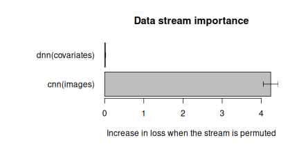
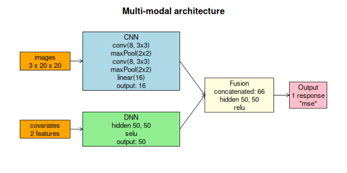

## Data Preparation of complex data

In Cito, the workflow for preparing complex data for Convolutional Neural Networks (CNNs) and Multimodal Neural Networks (MMNs) is the same. The only difference is that MMNs can process multiple data types simultaneously (see the 'MMN' section below).

Before we dive into the details, let's clarify how we represent different types of complex data in R using multidimensional arrays:

- Black/white image: $[height, width]$ with height/width being the number of pixels
- Colored images: $[3, height, width]$ 3 channels for the three colors
- LiDAR point clouds: $[x, y, z]$
- Environmental time series (can be also represented by an "image"): $[\text{time_steps}, \text{n_covariates}]$

Note: Cito currently supports up to three-dimensional inputs (excluding the sample dimension). Four-dimensional arrays, such as temporal RGB sequences $[3, height, width, time_steps]$, are not yet supported. Please contact us if you need support for 4D inputs.

### The format of the inputs we expect in cito

Whichever way the images reach cito (see the next section), the network receives them as one array per mini-batch, with the first dimension indexing samples. The subsequent dimensions then correspond to the data structure of each sample. Specifically:

- Grayscale images: $[\text{n_samples}, height, width]$
- RGB images: $[\text{n_samples}, 3, height, width]$
- LiDAR point clouds: $[\text{n_samples}, x, y, z]$
- Time series data: $[\text{n_samples}, time_steps, n_covariates]$

It is crucial that the order of samples in X matches the order of observations in your response (target) vector (or matrix for multiple response) y.

The rows of X, whatever form it takes, must be in the same order as the rows of the response Y.

### Three ways to provide images

`cnn()` and `mmn()` accept complex data in three forms. They differ in where the images live, in who does the preprocessing, and in how fast batches arrive at the network:

| | **A. Array in memory** | **B. Folder of image files** | **C. Windows of one large raster** |
|---|---|---|---|
| `X =` | `array [n, channels, height, width]` | `"path/to/folder"` | `raster_patches(...)` |
| Where the data live | in the R session | one file per observation on disk | one GeoTIFF on disk |
| Memory needed | the whole dataset | one batch | one batch |
| Preprocessing | yours, in R, before the fit | fixed: unsigned integers scaled to $[0, 1]$ | arguments of `raster_patches()`, stored with the model |
| Missing values | not allowed | not handled | handled (`fill`, `na_channel`) |
| Input dimensions | 1D, 2D or 3D | 2D images | 2D windows |
| Typical use | small and medium datasets, non-image data such as time series or voxels | photographs, camera traps, spectrograms, pre-extracted patches | remote sensing around observation sites, prediction maps |

#### A. An array in memory

The array is converted to a torch tensor once, and every batch is a slice of it. This is the fastest way to deliver batches, it accepts any input that fits the shapes above (time series, spectrograms, LiDAR voxels), and you have full control over normalization because you do it yourself. The cost is memory: the whole dataset sits in the R session, in double precision while you build it and in single precision inside the fit (see *Computational Considerations* below). The steps for building such an array from image files are described in [Preparing an array](#preparing-an-array) below.


``` r
X = array(runif(500 * 3 * 64 * 64), dim = c(500, 3, 64, 64))
Y = rnorm(500)
fit = cnn(X = X, Y = Y, architecture = create_architecture(conv(16), maxPool(), linear(32)))
```

#### B. A folder of image files

Pass the path of a folder instead of an array. cito reads only the images of the current batch, so the dataset is bounded by disk space, not by memory.


``` r
fit = cnn(X = "data/RGBimages/", Y = Y, architecture = create_architecture(conv(16), maxPool(), linear(32)),
          num_threads = 8L)
predict(fit, newdata = "data/RGBimages_test/")
```

- **Formats**: JPEG, PNG and TIFF, recognized by their content rather than by the file extension. TIFF files may have any number of bands, and 8, 16 or 32 bit integer or floating point samples, so multispectral patches can be stored as one TIFF per observation. All images must have the same size and number of channels.
- **Order**: the files are used in the order of `list.files()`, i.e. sorted by name. Give them zero-padded names (`0001.jpg`, `0002.jpg`, ...) and make sure that the rows of Y follow the same order.
- **Values**: unsigned integer images are divided by their maximum ($255$ for 8 bit, $65535$ for 16 bit) and arrive in $[0, 1]$. Floating point and signed integer TIFFs are passed unchanged, because they usually carry physical quantities; normalize them before writing the files.
- **Decoding** happens in compiled code (libjpeg, libpng, libtiff), in parallel over the images of a batch with `num_threads` threads. If cito was installed without these libraries, it falls back to R readers, which are correct but much slower. `cito:::cito_decoder_available()` shows which decoders are present.

The drawbacks: every observation needs its own file, prepared beforehand. Overlapping windows around nearby sites are stored several times, and JPEG is lossy and limited to three channels. Missing values cannot be represented except as an ordinary number.

#### C. Windows of one large raster

For remote sensing data around observation sites, extracting one file per site is often wasteful, and for a prediction map with one window per cell it is impossible: the patches would take far more space than the raster they are cut from. `raster_patches()` instead describes, for every observation, a square window of a large GeoTIFF centered on the observation's coordinates. The windows are read batch by batch while the network trains; nothing is extracted to disk, and the raster is never loaded into memory.


``` r
library(cito)
f = system.file("extdata", "raster.tif", package = "cito")
set.seed(1)
coords = cbind(x = runif(100, 600100, 600900), y = runif(100, 5300100, 5300700))
X = raster_patches(f, coords, extent = 200, standardize = TRUE, na_channel = TRUE)
X
#> 100 windows of 20 x 20 pixels x 4 channels from raster.tif (3 bands)
#>   preprocessing: (value - center) / scale, missing pixels = 0, plus a missing-pixel channel
#>   center: 13900 23900 33900 
#>   scale:  1724 1724 1724
dim(as.array(X[1:4]))
#> [1]  4  4 20 20
```

- `coords` are in the coordinate reference system of the raster, `extent` is the side length of the window in map units (here 200 m, i.e. 20 x 20 pixels of 10 m).
- **Preprocessing** is part of the input: `transform` (a function applied to each batch, e.g. a log transform or a band ratio), then `(value - center) / scale` per channel, or `standardize = TRUE` to estimate both from the training windows.
- **Missing pixels** (outside the raster, NoData, `NaN`) are set to `fill`, and `na_channel = TRUE` adds a channel that tells the network which pixels were imputed.
- **New sites** reuse the raster, window size and the training statistics with `like =`, so validation and prediction windows are scaled exactly like the training windows:


``` r
fit = cnn(X = X, Y = Y, architecture = create_architecture(conv(16), maxPool(), linear(32)))
predict(fit, newdata = raster_patches(coords = new_coords, like = X))
```

- `as.array(X[i])` returns windows exactly as the network receives them, which is the quickest way to check the preprocessing.
- In `mmn()`, every raster is its own `cnn()` term, so rasters of different resolution and coordinate system (e.g. 10 m imagery and 1 km climate) can be combined; each needs its own `raster_patches()` with coordinates in its own coordinate system.

- **Windows are placed on the pixel grid**: a coordinate rarely falls on a pixel corner, so the window is the block of whole pixels whose center is nearest to it, at most half a pixel away (5 m for 10 m imagery). Pixels are never interpolated, which would smooth the imagery and is meaningless for categorical rasters such as land cover; for fine imagery, the half pixel is usually below the positional error of the observations. With an even number of pixels per window, a site on a pixel center is always half a pixel off in the same direction; an odd number avoids that.

The limitations: one GeoTIFF per input (a mosaic of several tiles has to be merged into one file first), windows at the native resolution of the raster, and no time series.

**How the raster is stored matters more than anything else.** A GeoTIFF is compressed in blocks, and every read decompresses whole blocks. Most rasters are delivered *in strips*, the GDAL default: every block is one or a few full-width rows. A window of 1 x 1 km from a Bavaria-wide 10 m raster (37800 pixels wide) then needs 100 strips and decompresses 3.8 million pixels to use 10000. A *tiled* raster is cut into square blocks instead, and the same window decompresses only the one to four tiles it overlaps. The values are identical, only their arrangement in the file differs, and converting a raster is a single step, done once before training:


``` r
# in R; PREDICTOR=3 for floating point rasters
terra::writeRaster(terra::rast("s2_bavaria.tif"), "s2_bavaria_tiled.tif",
                   gdal = c("TILED=YES", "BLOCKXSIZE=128", "BLOCKYSIZE=128", "COMPRESS=DEFLATE", "PREDICTOR=2"))
```

or, for very large files, outside R with GDAL, which needs little memory:

```
gdal_translate -co TILED=YES -co BLOCKXSIZE=128 -co BLOCKYSIZE=128 \
               -co COMPRESS=DEFLATE -co PREDICTOR=2 -co BIGTIFF=IF_SAFER s2_bavaria.tif s2_bavaria_tiled.tif
```

`X$info$tiled` and `X$info$block` show how a raster is stored, and `raster_patches()` warns about a large raster in strips. Tiles of about the window size work best: in a benchmark with 100 x 100 pixel windows from a 37800 x 39000 pixel raster with 10 bands, one reader thread delivered 3 windows per second from the raster in strips, 169 from 256 x 256 tiles and 401 from 128 x 128 tiles (LZW-compressed strips, DEFLATE-compressed tiles; measured with a prototype of the reader).

#### Speed comparison

We measured how many images per second each route delivers, once for the data loader alone and once for a complete `cnn()` fit (a small CNN with two convolutional layers, batch size 64, three epochs, one 24 GB GPU, a multi-core server under moderate load from other jobs). All routes read the same windows, scaled to $[0, 1]$, with the files in the operating system's cache.

*RGB, 8 bit, 224 x 224 pixels, 2000 images:*

| Route | Loader, 1 thread | Loader, 8 threads | `cnn()`, 8 threads |
|---|---|---|---|
| A. Array in memory | 14160 | – | 548\* |
| B. Folder, JPEG | 1540 | 3867 | 783 |
| B. Folder, PNG | 863 | 3044 | 664 |
| B. Folder, TIFF | 979 | 2283 | 663 |
| C. Raster, tiled | 311 | 1196 | 686 |
| C. Raster, stripped | 51 | 330 | – |

*Multispectral, 10 bands, 16 bit, 100 x 100 pixels, 4000 images:*

| Route | Loader, 1 thread | Loader, 8 threads | `cnn()`, 8 threads |
|---|---|---|---|
| A. Array in memory | 28183 | – | 1895\* |
| B. Folder, TIFF | 784 | 1915 | 1101 |
| C. Raster, tiled | 159 | 1030 | 948 |
| C. Raster, stripped | 23 | 155 | – |

\*Includes converting the array to a tensor at the start of the fit. Every cell is a single run on a shared machine, so differences below a factor of about 1.5 between the `cnn()` rates are not resolved.

Three things follow:

1. For the RGB images, every route on disk delivers batches with a few threads about as fast as a small CNN on one GPU consumes them, so the network sets the pace. For the 10-band images, the fit from disk or raster runs at about half the rate of the fit from memory: there the loader sets the pace. A larger network shifts this towards the network.
2. Reading from a tiled raster is 2-5 times slower than reading pre-extracted TIFF files at the same thread count, and a raster stored in strips is another 2-7 times slower than the tiled one, more for wider rasters. Use tiled rasters.
3. `num_threads` of `cnn()` (default 4) matters for routes B and C: one thread leaves most of the speed unused. Do not set it higher than the number of physical cores. `mmn()` uses 4 threads.

The numbers are for files in the operating system's cache. When a large raster is read from a hard disk for the first time, every window costs a disk seek, and the loader drops to a few dozen windows per second; reading the file once beforehand (or keeping it on an SSD) avoids this.

#### Which one to choose

- The data fit comfortably into memory, or they are not images (time series, voxels): **A**.
- Images exist as files anyway (photographs, camera traps, spectrograms), or the dataset is larger than memory: **B**.
- Observations are points and the predictors are rasters, or you want to predict a map: **C**. With `like =` for validation and test sites built outside `cnn()`, their windows are scaled with the statistics of the training windows only.

### Preparing an array

The following workflow builds an array (route A) from image files on disk; it is one example among several possible ones.


#### 1. Preparing your data on disk
Although images can be saved in different formats, we recommend using formats for which an R function or R package is available to allow you to load the images into R.

Grayscale and RGB images should be saved as `.png` or `.jpeg`. Time series data can technically be interpreted as grayscale images and should therefore also be saved as `.png` or `.jpeg`.

However, LiDAR point clouds and/or other remote sensing data have more 'channels' (strictly, they do not have channels at all) than grayscale or RGB images and cannot therefore be saved as `.png` or `.jpeg`. Classical formats for saving such data are `.tiff` (GeoTIFF) and `.nc` (netCDF).

We recommend saving each image individually to your hard drive and using a naming strategy that allows the observation ID to be inferred from the image name. Here is an example:

```
project/
├── data/
│   ├── RGBimages/
│   │   ├── 001-img.jpeg
│   │   ├── 002-img.jpeg
│   │   ├── 003-img.jpeg
│   │   ├── 004-img.jpeg
│   │   └── ...
│   ├── LiDAR/
│   │   ├── 001-LiDAR.tiff
│   │   ├── 002-LiDAR.tiff
│   │   ├── 003-LiDAR.tiff
│   │   ├── 004-LiDAR.tiff
│   │   └── ...
│   └── Response/
│       └── Y.csv
└── code/
    ├── 01-CNN.R
    └── 02-MMN.R
```


#### 2. Load images into R

Before we can run/train cito, we must load the images into R, transform them into arrays, and concatenate the individual images of one input type into one array.

- Reading `.jpeg` files: This can be done either using the `imager` package via `as.array(imager::load.image("path-to-img.jpeg")))` or using the `torchvision` package (dependency of cito) via `torchvision::base_loader("path-to-img.jpeg")`
- Reading `.png` files: This can be done using the `torchvision` package (dependency of cito) via `torchvision::base_loader("path-to-img.jpeg")`
- Reading `.tiff` files:  `tiff::readTIFF("path-to-img.tiff")`
- Reading `.tiff` (GeoTIFF) files: `as.array(raster::brick("path-to-img.tiff"))`
- Reading `.nc` (netCDF) files: `ncdf4::ncvar_get(ncdf4::nc_open("path-to-img.nc"))`

Loop to read images into R:

First data type:

``` r
RGBimages_files = list.files(path = "RGBimages/", full.names = TRUE)
RGBimages = vector("list", length(RGBimages_files))

for(i in 1:length(RGBimages_files)) {
  RGBimages[[i]] = torchvision::base_loader(RGBimages_files[i])
}

```

Second data type:

``` r
LiDAR_files = list.files(path = "LiDAR/", full.names = TRUE)
LiDAR = vector("list", length(RGBimages_files))

for(i in 1:length(LiDAR_files)) {
  LiDAR[[i]] = torchvision::base_loader(LiDAR_files[i])
}

```

Change list of arrays into one array:

``` r
RGBimages = abind::abind(RGBimages, along = -1)
LiDAR = abind::abind(LiDAR, along = -1)
```

#### 3. Normalize and check channel dimension
Deep Neural Networks converge better when the inputs are normalized/standardized, for complex data, we can divide them by their max value to bring the values into the range of $[0, 1]$


``` r
RGBimages = RGBimages/max(RGBimages)
LiDAR = LiDAR/max(LiDAR)
```

Also, cito expects the channel dimension for RGB images to be in the second dimension. For LiDAR, the question is which dimension should be treated as the channel dimension. The channel dimension is treated slightly differently in CNN, so I would propose setting the z dimension as the channel dimension. However, when we read images into R, the channel dimension is usually the last dimension. In Cito, though, it must be the second dimension. (Reminder: our dimensions for RGB are currently: $[n, height, width, 3]$)


``` r
RGBimages = aperm(RGBimages, c(1, 4, 2, 3)) # change order of dimensions
LiDAR = aperm(LiDAR, c(1, 4, 2, 3))  # change order of dimensions
```


#### 4. Prepare tabular data (response and other tabular data such as altitude and spatial coordinates)
Read tabular data into R using the `read.csv` function. Predictors (e.g. spatial coordinates, altitude and climatic variables such as bioclim variables) should be standardized using the `scale` function.

**Note:** there should be no missing values in the data! If you have 1,000 images and 1,000 response values with NAs, Cito/R will drop the NA observations in the response, meaning the number of observations will no longer match up. Of course, there should also be no NAs in the images!

**Note:** The order of the tabular data (responses and predictors) should match the order of the images.


## Convolutional neural networks

We can setup the architecture of the CNN by using the `create_architecture` function. CNN usually consist of several convolutional layers, each layer followed by a pooling layer, and finally fully connected layers:


``` r
architecture <- create_architecture(conv(5), # convolutional layer with 5 kernels
                                    maxPool(),  # max pooling layer to reduce the dimension of the feature maps
                                    conv(5), # convolutional layer with 5 kernels
                                    maxPool(), # max pooling layer to reduce the dimension of the feature maps
                                    linear(10)) # fully connected layer
```

The idea is that the convolutional layers learn to extract structures from the images such as shapes and edges. These structures are then presented to the fully connected layer that is then doing the actual classification or regression.

Finding a good architecture can require a lot of experience and knowledge of CNNs. As an alternative, we recommend using transfer learning, which is also state of the art. Rather than training our own convolutional layers, we use a pre-trained CNN (usually trained on a large dataset with hundreds or thousands of response categories) and only train the final fully connected layer. It has been found that the convolutional layers often learn the same things, so there is no need to retrain them each time. This saves a lot of computational runtime, but more importantly, we don't need as much training data because we only have to train a small part of our model:


``` r
architecture <- create_architecture(transfer("resnet18"), # use pretrained resnet18 architecture
                                    linear(100)) # our fully connnected layer

```

Also, with that, we don't have to think about our own architecture!

Finally we can fit our model:

``` r
model <- cnn(X = LiDAR, Y, architecture, loss = "binomial",
              epochs = 10, validation = 0.1, lr = 0.05, device=device)

```

A complete, runnable example on simulated data, so that the syntax above can be checked rather
than taken on trust:


``` r
library(cito)
set.seed(42)
n <- 200
shapes <- cito:::simulate_shapes(n = n, size = 20, channels = 3)
covariates <- data.frame(Temp = runif(n), Precip = runif(n))
# the images carry most of the signal, one covariate a little
Y <- 3 * (as.integer(shapes$labels) - 1) + 0.4 * covariates$Temp + rnorm(n, sd = 0.2)

arch <- create_architecture(conv(8), maxPool(), conv(8), maxPool(), linear(16))
model <- mmn(Y ~ cnn(X = images, architecture = arch) +
                 dnn(~ Temp + Precip, data = covariates),
             dataList = list(Y = Y, images = shapes$data, covariates = covariates),
             loss = "mse", epochs = 150L, lr = 0.02, verbose = FALSE, plot = FALSE)
```

`summary()` reports how much each data stream contributed, by shuffling it across the batch and
measuring how much worse the model becomes. The standard deviation across permutations is given
beside the estimate: a stream that contributes little can come out negative by chance.


``` r
summary(model, n_permute = 5L)
#> Summary of Multi-Modal Neural Network
#> 
#> ── Permutation importance of the data streams
#>                                        Loss increase     SD  Share
#> cnn(X = images, architecture = arch)          4.1979 0.3867 0.9959
#> dnn(~Temp + Precip, data = covariates)        0.0174 0.0017 0.0041
#> 
#> Baseline loss 0.0455, 5 permutations per stream. A stream that contributes little
#> can come out negative by chance; compare the estimate against its SD before reading it.
```


``` r
plot(model, n_permute = 5L)
```



`plot_type = "arch"` draws the model itself: one row per data stream, its submodel, the width each
stream contributes to the concatenated representation, and the fusion network on top.


``` r
plot(model, plot_type = "arch")
```



Predicting on new data takes a named list with the same names:


``` r
newdata <- list(images = shapes$data[1:5, , , , drop = FALSE],
                covariates = covariates[1:5, ])
predict(model, newdata = newdata)
#>        [,1]
#> 1 3.2689741
#> 2 3.2994535
#> 3 0.4620387
#> 4 0.2301000
#> 5 0.2752702
```

Note:

1. The format of Y depends on the loss and your task.
2. Be aware of convergence issues; the loss should be higher than the baseline loss.
3. Use the validation split to monitor overfitting; training can be stopped automatically based on the validation loss using early stopping.

All of these points are described in the [Introduction to cito vignette](https://CRAN.R-project.org/package=cito) and apply to the `dnn()` and `cnn()` functions.

When the model is trained, we can make predictions via the `predict` method:


``` r
pred = predict(model, LiDAR) # by default predictions will be on the scale of the link (so no probabilities)
pred_proba = predict(model, LiDAR, type = "response") # change type to get probabilities
```

Model can be visualized via `plot(model)`


## Multi-modal neural networks
Multi-modal neural networks (MMNs) are useful when:

- There are different input data types, e.g. when combining LiDAR and optical satellite images (RGB images), or when combining LiDAR with tabular data (e.g. bioclimatic variables).
- You want to combine different resolutions of the same input data type
- Or both of the above

Each complex input data must be passed within its own multidimensional array and its own architecture:


``` r
architecture_LiDAR <- create_architecture(transfer("resnet18"))
architecture_RGBimages <- create_architecture(transfer("resnet18"))

model =
  mmn(Y ~
      cnn(X = LiDAR, architecture = architecture_LiDAR) +
      cnn(X = RGBimages, architecture = architecture_RGBimages) +
      dnn(~Temp+Precip, data = df),
      dataList = list(Y = df$Y, LiDAR = LiDAR, RGBimages = RGBimages, df = df),
      loss = 'binomial',
      optimizer = "adam")

```

**Important:** every object the formula refers to is looked up in `dataList`, by name. The response
is a bare name, not `df$Y`, and each `cnn(X = ...)` and `dnn(data = ...)` names an entry of the
list. Writing `dnn(~., data = df)` would take every column of `df` as a predictor, including the
response, so name the predictors explicitly or drop the response from the frame.

For multiple responses:


``` r
model =
  mmn(Y ~
      cnn(X = LiDAR, architecture = architecture_LiDAR) +
      cnn(X = RGBimages, architecture = architecture_RGBimages) +
      dnn(~Temp+Precip, data = df),
      dataList = list(Y = cbind(df$Y1, df$Y2, df$Y3), LiDAR = LiDAR,
                      RGBimages = RGBimages, df = df),
      loss = 'binomial',
      optimizer = "adam")
```

`newdata` is a named list, with the same names the model was fitted with:


``` r
predict(model, newdata = list(LiDAR = LiDAR, RGBimages = RGBimages, df = df), type = "response")
```


Multiple different responses with different losses:


``` r

custom_joint_loss = function(pred, true) {

  # first loss, e.g. binomial -> negative loglikelihood
  loss1 = -torch::distr_bernoulli(logits = torch_sigmoid(pred[,1]))$log_prob(true[,1])$mean()

  # second loss, e.g. mse
  loss2 = torch::nnf_mse_loss(pred[,2], true[,2])

  # third loss, e.g. poisson
  loss3 = -torch::distr_poisson(pred[,3]$exp())$log_prob(true[,3])$mean()

  # return joint loss
  return(loss1 + loss2 + loss3)
}

model =
  mmn(Y ~
      cnn(X = LiDAR, architecture = architecture_LiDAR) +
      cnn(X = RGBimages, architecture = architecture_RGBimages) +
      dnn(~Temp+Precip, data = df),
      dataList = list(Y = cbind(df$Y1, df$Y2, df$Y3), LiDAR = LiDAR,
                      RGBimages = RGBimages, df = df),
      loss = custom_joint_loss,
      epochs = 5L,
      optimizer = "adam")
```

A custom loss has no inverse link that cito could know about, so `type = "response"` cannot help
here and the links are applied to the predictions by hand:


``` r
pred = predict(model, newdata = list(LiDAR = LiDAR, RGBimages = RGBimages, df = df))
pred[,1] = plogis(pred[,1])
pred[,3] = exp(pred[,3])
```

Note:

1. The format of Y depends on the loss and your task.
2. Be aware of convergence issues; the loss should be higher than the baseline loss.
3. Use the validation split to monitor overfitting; training can be stopped automatically based on the validation loss using early stopping.

All of these points are described in the [Introduction to cito vignette](https://CRAN.R-project.org/package=cito) and apply to the `dnn()` and `cnn()` functions.


## Computational Considerations and Constraints

When working with convolutional neural networks (CNNs) and multimodal networks (MMNs), two critical computational factors are memory (RAM) and GPU availability.

### 1. GPU Requirements

CNNs benefit significantly from GPU acceleration:

- **Speed**: Training on a GPU is orders of magnitude faster than on a CPU.
- **Memory**: Due to the intensive tensor operations, we recommend a GPU with at least **12 GB** of VRAM to handle typical batch sizes (e.g., `batch_size = 20`).

### 2. System Memory (RAM)

How much memory you need depends on how the images reach cito:

- Passing an **array** holds every image in the session at once, so the number of observations is
  bounded by your RAM. The table below is the calculation for that case.
- Passing a **folder path** to `cnn(X = )` reads only the images of the current mini-batch, so the
  dataset size is bounded by disk rather than by RAM. The table below then does not apply, and the
  requirement is one batch at a time.
- Passing **`raster_patches()`** reads only the windows of the current mini-batch (and the next one,
  in the background) from the raster, so the raster can be far larger than RAM.

#### Example calculation when the images are held in memory (500 observations)

| Data Type                       | Dimensions             | Memory Usage           |
|---------------------------------|------------------------|------------------------|
| LiDAR volume                    | (500, 500, 500, 500)   | ~500 GB                |
| Optical satellite images        | (500, 3, 500, 500)     | ~3 GB                  |
| Tabular data                    | Negligible             | < 1 GB (ignored)       |
| Model parameters (~2.24 M)      | —                      | < 0.1 GB (negligible)  |
| **Total**                       |                        | **~503 GB**            |

Held in memory, that dataset would need **~550 GB** of system RAM; read from a folder, only one
batch is resident at a time. By contrast, GPU memory is less constraining because only one batch is loaded at a time on the GPU. For `batch_size = 20`, a 12–14 GB GPU should suffice.


**Summary**: The primary bottleneck is system RAM on the CPU, not VRAM on the GPU.


