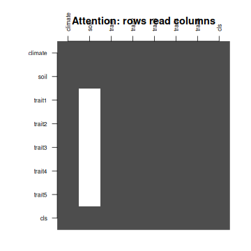

## Tokens

The right-hand side of a `tnn()` formula is a sum of token groups:

* `dnn()` and `cnn()` terms, written exactly as in `mmn()`, each become **one token**, named after their data;
* `tokens(M)` makes **one token per column** of the matrix `M`; a column token is a learned column embedding plus the embedded value, and `NA` is a learned *unknown* state;
* a learned `register` token, and a `cls` token from which the response is read out when the response is not itself tokenized.

## A transformer instead of the fusion network

With an ordinary response, `tnn()` is used like `mmn()`, and every loss of `mmn()` is available. Here two tabular sources and a trait matrix whose 5 columns become 5 tokens:


``` r
library(cito)
set.seed(1)
n = 500
climate = data.frame(temp = rnorm(n), prec = rnorm(n))
soil = data.frame(ph = rnorm(n), sand = rnorm(n))
traits = matrix(rnorm(n * 5), n, dimnames = list(NULL, paste0("trait", 1:5)))
y = matrix(climate$temp - 0.5 * soil$ph + 0.5 * traits[, 1] * climate$prec + rnorm(n, sd = 0.3))

fit = tnn(y ~ dnn(~ temp + prec, data = climate) + dnn(~ ph + sand, data = soil) + tokens(traits),
          dataList = list(y = y, climate = climate, soil = soil, traits = traits),
          epochs = 50L, validation = 0.2, plot = FALSE, verbose = FALSE)
fit
#> Transformer neural network: 2 modality token(s), 5 column token(s) + cls
#>   tokens of width 32, 2 layer(s), 4 head(s)
#> Call: tnn(formula = y ~ dnn(~temp + prec, data = climate) + dnn(~ph + sand, data = soil) + tokens(traits), dataList = list(y = y, climate = climate, soil = soil, traits = traits), validation = 0.2, epochs = 50L, plot = FALSE, verbose = FALSE)
cor(predict(fit), y)
#>           [,1]
#> [1,] 0.9762924
```

`summary()` permutes each token stream across rows and reports the increase in loss:


``` r
summary(fit, n_permute = 5L)
#> Summary of Transformer Neural Network
#> 
#> ── Permutation importance of the token streams
#>         Loss increase     SD  Share
#> climate        2.2278 0.0525 0.6952
#> soil           0.5262 0.0319 0.1642
#> traits         0.4506 0.0200 0.1406
#> 
#> Baseline loss 0.0861, 5 permutations per stream. Compare an estimate against its SD before reading it.
```

## Attention as formulas

By default every token reads every token. A rule `readers ~ readable` replaces what the readers may read; rules are applied in order, and sets are written with token names, names of `groups`, `.` (all), `0` (none), `+` and `-`. Here the trait tokens may not read the soil token:


``` r
fit2 = tnn(y ~ dnn(~ temp + prec, data = climate) + dnn(~ ph + sand, data = soil) + tokens(traits),
           dataList = list(y = y, climate = climate, soil = soil, traits = traits),
           attention = list(traits ~ . - soil),
           epochs = 5L, plot = FALSE, verbose = FALSE)
```


``` r
plot(fit2, plot_type = "attention")
```



## The response as tokens

When the response enters as `tokens(Y)`, its columns are tokens too. Training hides a random fraction of the observed cells of every row, draws it anew in every minibatch, and scores only the hidden cells. A single fitted model then answers the unconditional question (every column from the other tokens) and conditional ones (some columns from the observed values of others). For a site x species matrix this is a joint species distribution model that can be queried with a partial survey.


``` r
set.seed(2)
S = 10
env = data.frame(temp = rnorm(n), prec = rnorm(n))
latent = rnorm(n)
Y = sapply(1:S, function(j) rbinom(n, 1, plogis((j - 5) / 3 * env$temp + (if(j <= 5) 1.5 else -1.5) * latent)))
colnames(Y) = paste0("sp", 1:S)

fit3 = tnn(Y ~ dnn(~ temp + prec, data = env) + tokens(Y), dataList = list(Y = Y, env = env),
           loss = "bernoulli", groups = list(first = paste0("sp", 1:5), second = paste0("sp", 6:10)),
           epochs = 100L, validation = 0.2, plot = FALSE, verbose = FALSE)
```

The unconditional prediction uses the environment only:


``` r
p0 = predict(fit3, type = "response")
```

A query `targets ~ given` predicts the first five species from the observed second five:


``` r
p1 = predict(fit3, Y = Y, query = first ~ second, type = "response")
loss = function(p, y) -mean(y * log(p) + (1 - y) * log(1 - p))
c(unconditional = loss(p0[, 1:5], Y[, 1:5]), given_second = loss(p1[, 1:5], Y[, 1:5]))
#> unconditional  given_second 
#>     0.6544035     0.5914217
```

The second half carries the unmeasured `latent` driver, so knowing it improves the prediction of the first half. `loo = TRUE` predicts every species from all others, and `summary()` reports the same gain for the whole response as the row "(given values)". The gain is not a measure of interactions between species: shared responses to unmeasured predictors, as here, produce it as well.


``` r
summary(fit3, n_permute = 5L)
#> Summary of Transformer Neural Network
#> 
#> ── Permutation importance of the token streams
#>                  Loss increase     SD  Share
#> env                     0.0933 0.0066 0.5843
#> Y (given values)        0.0664     NA 0.4157
#> 
#> Baseline loss 0.5725 (hidden cells of one fixed mask), 5 permutations per stream. Compare an estimate against its SD before reading it.
```

## Choosing what is trained

`masking = hidden ~ given` sorts the response columns: columns only on the left are always hidden, columns only on the right are never hidden, columns on both sides are hidden at random, columns on neither side are never used. The default `. ~ .` trains every conditional query; `. ~ 0` trains the unconditional prediction only; `first ~ second` trains exactly the query above. `predict()` answers only what the masking trained.


``` r
fit4 = tnn(Y ~ dnn(~ temp + prec, data = env) + tokens(Y), dataList = list(Y = Y, env = env),
           loss = "bernoulli", groups = list(first = paste0("sp", 1:5), second = paste0("sp", 6:10)),
           masking = first ~ second, epochs = 100L, validation = 0.2, plot = FALSE, verbose = FALSE)
p2 = predict(fit4, Y = Y, query = first ~ second, type = "response")
loss(p2[, 1:5], Y[, 1:5])
#> [1] 0.502836
```

Note that the losses above are in-sample; for an honest comparison, predict held-out rows with `newdata` and `Y`.
